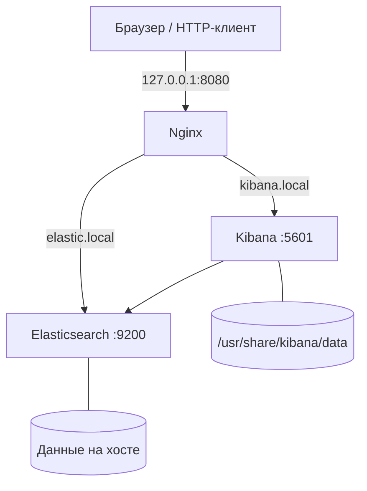

# Global Elasticsearch Stack

[](https://github.com/yaleksandr89/docker-elasticsearch)
[](https://www.elastic.co/elasticsearch)
[](https://www.elastic.co/kibana)
[](https://nginx.org/)
[](https://www.docker.com/)
[](https://github.com/yaleksandr89/docker-elasticsearch/actions/workflows/ci.yml)
[](LICENSE.md)

## Выберите язык

| Русский | English | Español | 中文 | Français | Deutsch |
|---|---|---|---|---|---|
| **Выбран** | [English](docs/langs/en/README.md) | [Español](docs/langs/es/README.md) | [中文](docs/langs/zh/README.md) | [Français](docs/langs/fr/README.md) | [Deutsch](docs/langs/de/README.md) |

Локальный учебный стенд для знакомства с Elasticsearch: индексы, документы, полнотекстовый поиск, фильтры, агрегации и анализ текста. Kibana позволяет выполнять запросы в Dev Tools и исследовать данные; Nginx направляет HTTP-запросы к нужному сервису. Стенд не содержит готовой базы товаров: учебный индекс создаётся по руководству.

Только для обучения на синтетических данных. Локальные процессы, браузер и пользователи Docker могут обращаться к стенду по HTTP без пароля. Не публикуйте его в интернете.

## Возможности

- Один узел Elasticsearch с JVM heap 2 ГиБ; плагины `analysis-icu` и `analysis-phonetic` устанавливаются при сборке.
- Kibana для запросов и визуального исследования; Nginx для двух виртуальных хостов.
- Готовый учебный mapping, небольшой синтетический набор данных и примеры Query DSL.
- Словарь географических синонимов включён в образ; анализатор нужно настроить явно.

## Архитектура стенда



В локальном сценарии только Nginx доступен с хоста через loopback. Порты `9200` и `5601` используются внутри сети Compose; Elasticsearch сохраняет индексы в каталоге хоста. Kibana обращается к Elasticsearch внутри сети, а не через публичный домен.

## Требования

Git, GNU Make, Bash, curl, Docker Engine 28+ или Docker Desktop с Compose v2.14.2+. Рекомендуется Linux, macOS или Windows с WSL2. Для первоначальной сборки нужны доступ к официальным registry, репозиториям ОС и серверу плагинов, свободный диск и минимум 4 ГиБ доступной памяти (лучше 6–8 ГиБ); 2 ГиБ выделены JVM Elasticsearch, а Kibana и Docker требуют дополнительную память.

## Быстрый старт

```bash
git clone https://github.com/yaleksandr89/docker-elasticsearch.git
cd docker-elasticsearch
make init
make config
```

Перед сборкой проверьте свободный порт, память Docker, уникальность проекта и трёх имён контейнеров. В выводе `make config` должна быть только сеть `backend` и одна публикация `127.0.0.1:8080`. Для второй копии задайте другие имена, порт и оба каталога. Оба каталога должны быть доступны для записи пользователям образов.

Перед сборкой прочитайте [Начало работы](docs/langs/ru/guides/getting-started.md).

```bash
docker compose ls -a
docker ps -a
ls -ld data/elasticsearch data/kibana
make build
make up
```

После успешной HTTP-проверки Elasticsearch Compose запускает Kibana в фоне. Проверьте готовность Kibana через /api/status. При смене домена или порта измените адреса в примерах. [Kibana](http://kibana.local:8080) · [Elasticsearch](http://elastic.local:8080)

```bash
curl --noproxy '*' --resolve elastic.local:8080:127.0.0.1 --fail --silent --show-error --max-time 10 http://elastic.local:8080/
curl --noproxy '*' --resolve kibana.local:8080:127.0.0.1 --fail --silent --show-error --max-time 10 http://kibana.local:8080/api/status
```

[Начало работы](docs/langs/ru/guides/getting-started.md) · [Практика поиска и анализа текста](docs/langs/ru/guides/search-lab.md)

## Проверки

CI запускается для push и pull request в `master`, а также вручную через Actions. `quality` проверяет синтаксис startup-скриптов, учебные fixtures и resolved Compose; `docker-smoke` собирает отдельный стенд на фиксированных версиях, проверяет HTTP через оба virtual host, плагины и учебный поиск. Факт успешного запуска подтверждают результаты CI, а не наличие workflow.

## Документация

- [Начало работы](docs/langs/ru/guides/getting-started.md)
- [Практика поиска и анализа текста](docs/langs/ru/guides/search-lab.md)
- [Эксплуатация и Make-команды](docs/langs/ru/guides/operations.md)
- [Диагностика](docs/langs/ru/guides/troubleshooting.md)
- [Архитектура и конфигурация](docs/langs/ru/reference/configuration.md)
- [Участие в разработке](.github/CONTRIBUTING.md)

## Обратная связь

- Воспроизводимые ошибки — [GitHub Issues](https://github.com/yaleksandr89/docker-elasticsearch/issues).
- Вопросы и идеи — [GitHub Discussions](https://github.com/yaleksandr89/docker-elasticsearch/discussions).

---

<p align="center">
  Если проект оказался полезен, поставьте звезду на GitHub — так его будет проще найти другим разработчикам.
</p>
