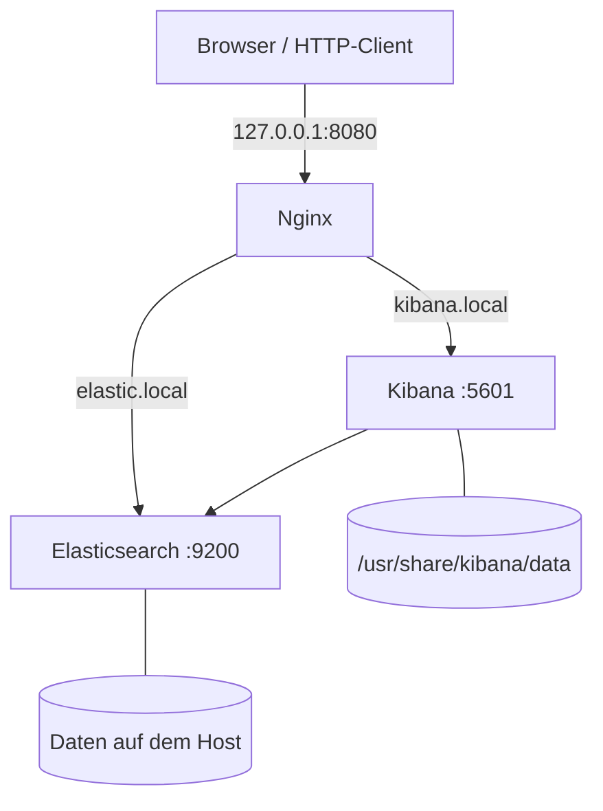

# Global Elasticsearch Stack

[](https://github.com/yaleksandr89/docker-elasticsearch)
[](https://www.elastic.co/elasticsearch)
[](https://www.elastic.co/kibana)
[](https://nginx.org/)
[](https://www.docker.com/)
[](https://github.com/yaleksandr89/docker-elasticsearch/actions/workflows/ci.yml)
[](../../../LICENSE.md)

## Sprache wählen

| Русский | English | Español | 中文 | Français | Deutsch |
|---|---|---|---|---|---|
| [Русский](../../../README.md) | [English](../en/README.md) | [Español](../es/README.md) | [中文](../zh/README.md) | [Français](../fr/README.md) | **Ausgewählt** |

Ein lokales Lernlabor für Elasticsearch: Indizes, Dokumente, Volltextsuche, Filter, Aggregationen und Textanalyse. Kibana bietet Dev Tools und Datenexploration; Nginx leitet HTTP-Anfragen an den passenden Dienst weiter. Es gibt keine vorinstallierte Produktdatenbank: Der Übungsindex wird anhand der Anleitung erstellt.

Nur synthetische Daten verwenden. Lokale Prozesse, Browser und Benutzer mit Docker-Zugriff können das Labor ohne Anmeldung über HTTP erreichen. Nicht im Internet veröffentlichen.

## Funktionen

- Elasticsearch als Einzelknoten mit 2 GiB JVM-Heap; `analysis-icu` und `analysis-phonetic` werden beim Build installiert.
- Kibana für Abfragen und visuelle Exploration; Nginx für zwei virtuelle Hosts.
- Ein Übungs-Mapping, ein kleiner synthetischer Datensatz und Query-DSL-Beispiele.
- Ein geografisches Synonymwörterbuch liegt im Image; ein Analyzer muss ausdrücklich konfiguriert werden.

## Laborarchitektur



Im lokalen Modus wird nur Nginx am Host über Loopback veröffentlicht. `9200` und `5601` sind interne Compose-Netzwerkports; Elasticsearch speichert Indizes in einem Host-Verzeichnis. Kibana verbindet sich innerhalb des Netzwerks mit Elasticsearch, nicht über dessen öffentliche Domain.

## Voraussetzungen

Git, GNU Make, Bash, curl, Docker Engine 28+ oder Docker Desktop mit Compose v2.14.2+. Empfohlen: Linux, macOS oder Windows mit WSL2. Der erste Build benötigt Zugang zu offiziellen Registries, OS-Paketquellen und Plugin-Server, freien Speicherplatz sowie mindestens 4 GiB verfügbaren RAM (6–8 GiB empfohlen); Elasticsearch nutzt 2 GiB JVM-Heap, Kibana und Docker brauchen zusätzlichen Speicher.

## Schnellstart

```bash
git clone https://github.com/yaleksandr89/docker-elasticsearch.git
cd docker-elasticsearch
make init
make config
```

Vor dem Build freien Port, Docker-Speicher sowie Projekt- und Containernamen prüfen. In `make config` darf nur das Netz `backend` erscheinen und nur `127.0.0.1:8080` veröffentlicht sein. Für eine zweite Kopie eigene Namen, einen freien Port und zwei separate Datenverzeichnisse wählen. Die Image-Benutzer brauchen dort Schreibzugriff.

Vor dem Build lesen: [Erste Schritte](guides/getting-started.md).

```bash
docker compose ls -a
docker ps -a
ls -ld data/elasticsearch data/kibana
make build
make up
```

Nach erfolgreicher HTTP-Prüfung von Elasticsearch startet Compose Kibana im Hintergrund. Die Bereitschaft von Kibana über /api/status prüfen. Bei eigenen Domains oder Ports die Beispiel-URLs anpassen. [Kibana](http://kibana.local:8080) · [Elasticsearch](http://elastic.local:8080)

```bash
curl --noproxy '*' --resolve elastic.local:8080:127.0.0.1 --fail --silent --show-error --max-time 10 http://elastic.local:8080/
curl --noproxy '*' --resolve kibana.local:8080:127.0.0.1 --fail --silent --show-error --max-time 10 http://kibana.local:8080/api/status
```

[Erste Schritte](guides/getting-started.md) · [Übungen zu Suche und Textanalyse](guides/search-lab.md)

## Prüfungen

CI läuft bei Push und Pull Request auf `master` sowie manuell über Actions. `quality` prüft Startup-Skriptsyntax, Übungs-Fixtures und aufgelöstes Compose; `docker-smoke` baut isoliert mit festen Versionen und prüft HTTP über beide virtuellen Hosts, Plugins und Suche. Nur CI-Ergebnisse belegen Erfolg, nicht das Vorhandensein des Workflows.

## Dokumentation

- [Erste Schritte](guides/getting-started.md)
- [Übungen zu Suche und Textanalyse](guides/search-lab.md)
- [Betrieb und Make-Befehle](guides/operations.md)
- [Fehlerbehebung](guides/troubleshooting.md)
- [Architektur und Konfiguration](reference/configuration.md)
- [Mitwirken](CONTRIBUTING.md)

## Feedback

- Reproduzierbare Fehler: [GitHub Issues](https://github.com/yaleksandr89/docker-elasticsearch/issues).
- Fragen und Ideen: [GitHub Discussions](https://github.com/yaleksandr89/docker-elasticsearch/discussions).

---

<p align="center">
  Wenn das Projekt hilfreich war, geben Sie ihm einen Stern auf GitHub, damit andere Entwickler es leichter finden können.
</p>
