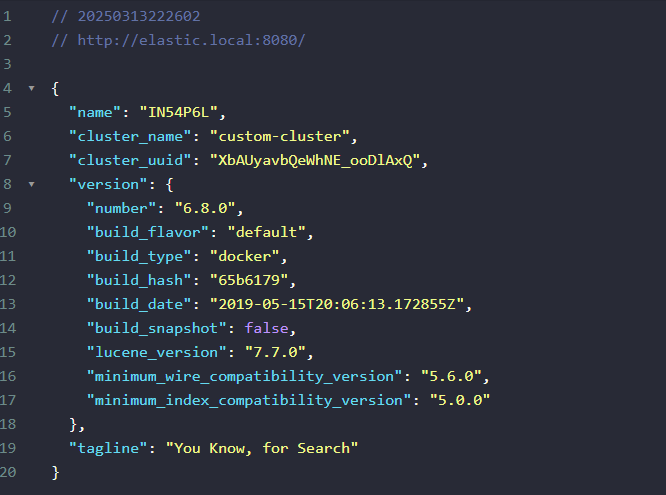

# Erste Schritte

## Sprache wählen

| Русский | English | Español | 中文 | Français | Deutsch |
|---|---|---|---|---|---|
| [Русский](../../ru/guides/getting-started.md) | [English](../../en/guides/getting-started.md) | [Español](../../es/guides/getting-started.md) | [中文](../../zh/guides/getting-started.md) | [Français](../../fr/guides/getting-started.md) | **Ausgewählt** |

Ein lokales Lernlabor für Elasticsearch: Indizes, Dokumente, Volltextsuche, Filter, Aggregationen und Textanalyse. Kibana bietet Dev Tools und Datenexploration; Nginx leitet HTTP-Anfragen an den passenden Dienst weiter. Es gibt keine vorinstallierte Produktdatenbank: Der Übungsindex wird anhand der Anleitung erstellt.

Nur synthetische Daten verwenden. Lokale Prozesse, Browser und Benutzer mit Docker-Zugriff können das Labor ohne Anmeldung über HTTP erreichen. Nicht im Internet veröffentlichen.

## Voraussetzungen

Git, GNU Make, Bash, curl, Docker Engine 28+ oder Docker Desktop mit Compose v2.14.2+. Empfohlen: Linux, macOS oder Windows mit WSL2. Der erste Build benötigt Zugang zu offiziellen Registries, OS-Paketquellen und Plugin-Server, freien Speicherplatz sowie mindestens 4 GiB verfügbaren RAM (6–8 GiB empfohlen); Elasticsearch nutzt 2 GiB JVM-Heap, Kibana und Docker brauchen zusätzlichen Speicher.

## Host vorbereiten

Prüfen Sie Versionen und Ressourcen vor dem Start. Unter Linux und in der Linux-Umgebung von Docker/WSL `vm.max_map_count` prüfen; für aktuelles Elasticsearch gilt offiziell `1048576` als Richtwert. Ist der Wert niedriger und meldet Elasticsearch einen Bootstrap-Check, konfigurieren Sie den tatsächlich Docker ausführenden Kernel nach der [offiziellen Anleitung](https://www.elastic.co/docs/deploy-manage/deploy/self-managed/vm-max-map-count). Host-Einstellungen nicht blind ändern. Docker Desktop weist seiner VM Speicher zu.

```bash
docker version
docker compose version
make --version
# Linux / WSL
sysctl vm.max_map_count
```

## Schnellstart

```bash
git clone https://github.com/yaleksandr89/docker-elasticsearch.git
cd docker-elasticsearch
make init
make config
```

Vor dem Build freien Port, Docker-Speicher sowie Projekt- und Containernamen prüfen. In `make config` darf nur das Netz `backend` erscheinen und nur `127.0.0.1:8080` veröffentlicht sein. Für eine zweite Kopie eigene Namen, einen freien Port und zwei separate Datenverzeichnisse wählen. Die Image-Benutzer brauchen dort Schreibzugriff.

```bash
docker compose ls -a
docker ps -a
ls -ld data/elasticsearch data/kibana
make build
```

`make init` behält eine vorhandene `.docker.env` bei und legt fehlende Verzeichnisse an. Die Berechtigungen bleiben erhalten. Elasticsearch verwendet UID 1000 und primäre GID 0. Kibana verwendet UID 1000, primäre GID 1000 und Zusatzgruppe 0. Die Befehle gelten für eine frische Kopie unter lokalem Linux mit Standardwerten. Pfade in `make config`, effektive IDs, Eigentümer und leere Verzeichnisse prüfen.

```bash
docker run --rm --network none --read-only --entrypoint id docker-elasticsearch-elasticsearch
docker run --rm --network none --read-only --entrypoint id docker-elasticsearch-kibana
id
ls -ldn data/elasticsearch data/kibana
find data/elasticsearch data/kibana -mindepth 1 -maxdepth 1 -print
```

Wenn die Image-UID vom Eigentümer abweicht und keinen Zugriff hat, kann der Eigentümer ihn auf diese zwei neuen leeren Verzeichnisse beschränken. Das Beispiel erst nach Prüfung der UID 1000 und der genauen Pfade ausführen. Es setzt die optionalen Werkzeuge `setfacl` und `getfacl` und ein lokales Dateisystem mit POSIX ACLs voraus. Andernfalls mit dem Eigentümer einen neuen beschreibbaren Pfad vereinbaren. Bestehende Datenverzeichnisse unangetastet lassen.

```bash
setfacl -m u:1000:rwx -- data/elasticsearch data/kibana
getfacl -- data/elasticsearch data/kibana
```

```bash
make up
```

Nach erfolgreicher HTTP-Prüfung von Elasticsearch startet Compose Kibana im Hintergrund. Die Bereitschaft von Kibana über /api/status prüfen. Bei eigenen Domains oder Ports die Beispiel-URLs anpassen. [Kibana](http://kibana.local:8080) · [Elasticsearch](http://elastic.local:8080)

## Verbindung und Bereitschaft

Für den Browser diese zwei Einträge in die hosts-Datei des Betriebssystems aufnehmen, auf dem er läuft: Linux/macOS `/etc/hosts`, Windows `C:\Windows\System32\drivers\etc\hosts` (entsprechende Rechte erforderlich). Curl benötigt keine hosts-Änderung: `--resolve` leitet die Anfrage mit dem richtigen Host an Loopback.

```text
127.0.0.1    elastic.local
127.0.0.1    kibana.local
```

```bash
curl --noproxy '*' --resolve elastic.local:8080:127.0.0.1 --fail --silent --show-error --max-time 10 http://elastic.local:8080/
curl --noproxy '*' --resolve elastic.local:8080:127.0.0.1 --fail --silent --show-error --max-time 10 'http://elastic.local:8080/_cluster/health?pretty'
curl --noproxy '*' --resolve elastic.local:8080:127.0.0.1 --fail --silent --show-error --max-time 10 'http://elastic.local:8080/_cat/plugins?v'
curl --noproxy '*' --resolve kibana.local:8080:127.0.0.1 --fail --silent --show-error --max-time 10 http://kibana.local:8080/api/status
```

Die Elasticsearch-Wurzelantwort enthält `version.number` und `cluster_name`; `_cluster/health` meldet den Zustand. `green` bedeutet alle Shards verfügbar, `yellow` beim Einzelknoten kann nicht zugewiesene Replikate bedeuten, `red` erfordert Diagnose. Beide Plugins müssen in `_cat/plugins` erscheinen. Kibana ist bereit, wenn `/api/status` `status.overall.level: available` meldet; vorher sind 502/503 möglich. Danach [Kibana](http://kibana.local:8080) und Dev Tools → Console öffnen.

[Fehler beim Start eingrenzen](troubleshooting.md) · [Übungen zu Suche und Textanalyse](search-lab.md)

## Historische Screenshots

Die ursprünglichen Abbildungen des früheren Labors (Elasticsearch 6.8.0) bleiben erhalten. Aktuelle Versionen unterscheiden sich in Darstellung, Menüs und Antworten; die Bilder belegen keinen aktuellen Lauf.




## Dokumentation

- [Übungen zu Suche und Textanalyse](search-lab.md)
- [Betrieb und Make-Befehle](operations.md)
- [Fehlerbehebung](troubleshooting.md)
- [Architektur und Konfiguration](../reference/configuration.md)
- [Mitwirken](../CONTRIBUTING.md)
