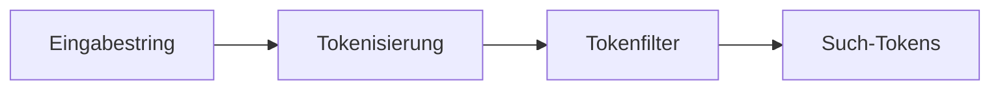

# Übungen zu Suche und Textanalyse

## Sprache wählen

| Русский | English | Español | 中文 | Français | Deutsch |
|---|---|---|---|---|---|
| [Русский](../../ru/guides/search-lab.md) | [English](../../en/guides/search-lab.md) | [Español](../../es/guides/search-lab.md) | [中文](../../zh/guides/search-lab.md) | [Français](../../fr/guides/search-lab.md) | **Ausgewählt** |

Ziel: einen separaten Übungsindex erstellen, `text` und `keyword` unterscheiden sowie Query DSL, Analyzer und Aggregationen vergleichen. Nur im isolierten lokalen Labor der Anleitung ausführen. Synthetische Daten, IDs 1–3. Die folgenden Ergebnisse sind Erwartungen, keine protokollierte Ausführung.

[Erste Schritte](getting-started.md)

## Index erstellen und Daten laden

[`products-index.json`](../../../examples/products-index.json) · [`products.ndjson`](../../../examples/products.ndjson)

Mapping beschreibt Feldtypen. `title` ist analysierter Text mit eigenem Synonym-Suchanalyzer; `title.folded` ein Multi-Field für Unicode-Folding, `brand.sound` ein phonetisches Multi-Field, `category` ein exakter Wert für Filter/Aggregationen, `price` eine Zahl und `in_stock` ein Boolean. Ein Primary-Shard und null Replikate für die Einzelknoten-Übung.

Vom Repository-Stamm prüfen, dass `es-lab-products` nicht existiert (HTTP 404). Existiert er, keine fremden Dokumente überschreiben; zuerst die Zugehörigkeit prüfen. `PUT` erstellt den Index mit explizitem Mapping; `_bulk` akzeptiert NDJSON mit abschließendem Zeilenumbruch. `refresh=wait_for` wartet auf Suchsichtbarkeit. Prüfen Sie `acknowledged: true`, `errors: false` in Bulk und Anzahl 3.

```bash
es() {
    curl --noproxy '*' --resolve elastic.local:8080:127.0.0.1 --fail --silent --show-error --max-time 30 "$@"
}
status=$(curl --noproxy '*' --resolve elastic.local:8080:127.0.0.1 --silent --show-error --max-time 10 --head --output /dev/null --write-out '%{http_code}' http://elastic.local:8080/es-lab-products)
test "$status" = 404
```

```bash
test "$status" = 404 && es -X PUT -H 'Content-Type: application/json' --data-binary @docs/examples/products-index.json http://elastic.local:8080/es-lab-products
```

Nur nach `acknowledged: true` fortfahren; bei fehlgeschlagener Indexerstellung stoppen. Bulk nutzt `create`: erneutes Laden überschreibt keine vorhandenen IDs, Teilfehler sind aber möglich (`errors` und `items` prüfen).

```bash
es -X POST -H 'Content-Type: application/x-ndjson' --data-binary @docs/examples/products.ndjson 'http://elastic.local:8080/es-lab-products/_bulk?refresh=wait_for'
es 'http://elastic.local:8080/es-lab-products/_count?pretty'
```

## Query DSL: Suche, Filter und Aggregationen

Die folgenden Blöcke einzeln in Kibana Dev Tools → Console ausführen. `hits.hits` (Dokumente), `_score` (Relevanz) und `aggregations` prüfen. Die Reihenfolge bei gleichem Score ist nicht garantiert.

`match` analysiert die Anfrage. Das Suchsynonym `laptop, notebook` sollte Dokumente 1 und 2 liefern.

```http
GET es-lab-products/_search
{"query":{"match":{"title":"laptop"}}}
```

`term` trifft ein exaktes `keyword` ohne String-Analyse. Erwartet 1 und 2. `term` auf `text` ersetzt keine Volltextabfrage `match`.

```http
GET es-lab-products/_search
{"query":{"term":{"category":"computers"}}}
```

`bool.must` beeinflusst die Relevanz, `filter` begrenzt ohne Bewertung. Für verfügbare Laptops bis 1000 wird nur Dokument 1 erwartet.

```http
GET es-lab-products/_search
{
  "query": {
    "bool": {
      "must": {"match": {"title": "laptop"}},
      "filter": [
        {"term": {"in_stock": true}},
        {"range": {"price": {"lte": 1000}}}
      ]
    }
  }
}
```

`terms` gruppiert nach `category`. Mit `size: 0` kommen nur Metadaten und Aggregationen: erwartet `computers: 2`, `audio: 1`.

```http
GET es-lab-products/_search
{"size":0,"aggs":{"categories":{"terms":{"field":"category"}}}}
```

## Funktionsweise der Textanalyse



Ein Analyzer wandelt Strings in Tokens um. Beim Indexieren landen sie im invertierten Index, beim Suchen dienen sie dem Abgleich. `_analyze` zeigt das Ergebnis ohne Dokument hinzuzufügen. Suchzeit-Synonyme erweitern die Anfrage, ohne `_source` zu ändern.

```http
POST es-lab-products/_analyze
{"analyzer":"lab_search","text":"laptop"}
```

ICU-Folding normalisiert Unicode einschließlich diakritischer Zeichen. Tokens für `Café` und `cafe` vergleichen, dann `title.folded` suchen: erwartet 3. Keine universelle Übersetzung.

```http
POST es-lab-products/_analyze
{"analyzer":"lab_icu","text":["Café","cafe"]}

GET es-lab-products/_search
{"query":{"match":{"title.folded":"cafe"}}}
```

Double Metaphone kodiert Klang. `Smith` und `Smyth` sollten über `brand.sound` übereinstimmen (1 und 2). Das normale Feld `brand` bleibt separat suchbar: Phonetik kann Fehlmatches erzeugen und ist sprachabhängig.

```http
POST es-lab-products/_analyze
{"analyzer":"lab_sound","text":["Smith","Smyth"]}

GET es-lab-products/_search
{"query":{"match":{"brand.sound":"Smith"}}}
```

Das Wörterbuch `analysis/synonyms.txt` wird beim Build in die Elasticsearch-Konfiguration kopiert, aber nicht automatisch dem Standard-Analyzer zugeordnet. Explizit mit `_analyze` testen; unter Tokens für `russia` wird `россия` erwartet. Es enthält geografische Namensvarianten, kein allgemeines Sprachwörterbuch, und kann redaktionelle Prüfung benötigen. Für Mehrwortsynonyme `synonym_graph` zur Suchzeit verwenden. Dateiänderungen erfordern einen neuen Image-Build und passende Analyzer-Änderungen; keine automatische Reindexierung.

```http
POST /_analyze
{
  "tokenizer": "standard",
  "filter": ["lowercase", {"type":"synonym_graph","synonyms_path":"analysis/synonyms.txt"}],
  "text": "russia"
}
```

## Kibana Discover

In Kibana Discover eine Data View für `es-lab-products` ohne Zeitfeld erstellen (Mapping enthält keinen Timestamp). Dokumente öffnen, `category`, `price`, `in_stock` hinzufügen und Filter mit Query DSL vergleichen. Menünamen können versionsabhängig sein.

## Übung beenden

Den Index für weitere Abfragen behalten. Nur wenn sicher von Ihnen in diesem Wegwerflabor erstellt und nicht mehr benötigt, löscht folgender Befehl alle Dokumente und Mapping ohne automatische Wiederherstellung. Keine Wildcards und keinen fremden Cluster verwenden.

```http
DELETE es-lab-products
```

## Offizielle Dokumentation

- [Match query](https://www.elastic.co/docs/reference/query-languages/query-dsl/query-dsl-match-query)
- [ICU analysis](https://www.elastic.co/docs/reference/elasticsearch/plugins/analysis-icu)
- [Phonetic filter](https://www.elastic.co/docs/reference/elasticsearch/plugins/analysis-phonetic-token-filter)
- [Synonym graph](https://www.elastic.co/docs/reference/text-analysis/analysis-synonym-graph-tokenfilter)

## Dokumentation

- [Erste Schritte](getting-started.md)
- [Betrieb und Make-Befehle](operations.md)
- [Fehlerbehebung](troubleshooting.md)
- [Architektur und Konfiguration](../reference/configuration.md)
- [Mitwirken](../CONTRIBUTING.md)
