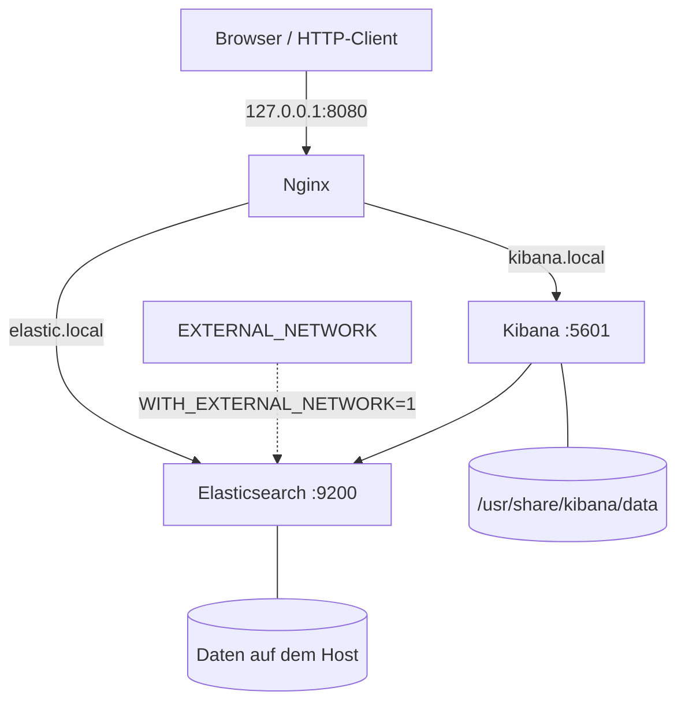

# Architektur und Konfiguration

## Sprache wählen

| Русский | English | Español | 中文 | Français | Deutsch |
|---|---|---|---|---|---|
| [Русский](../../ru/reference/configuration.md) | [English](../../en/reference/configuration.md) | [Español](../../es/reference/configuration.md) | [中文](../../zh/reference/configuration.md) | [Français](../../fr/reference/configuration.md) | **Ausgewählt** |

Make liest `.docker.env` als vertrauenswürdige lokale Konfiguration. Bestehende Einstellungen erhalten und vor dem Start mit alten Daten den Upgrade-Pfad prüfen. Auch bei direkten Compose-Aufrufen gelten genaue Versionen, eindeutige Namen und feste interne Ports.

[`.docker.env.example`](../../../../.docker.env.example) · [`docker-compose.yml`](../../../../docker-compose.yml) · [`docker-compose.external.yml`](../../../../docker-compose.external.yml) · [`docker-configs/elasticsearch/elasticsearch.yml`](../../../../docker-configs/elasticsearch/elasticsearch.yml) · [`docker-configs/kibana/Dockerfile`](../../../../docker-configs/kibana/Dockerfile) · [`docker-configs/nginx/default.conf.template`](../../../../docker-configs/nginx/default.conf.template)

Nur synthetische Daten verwenden. Lokale Prozesse, Browser und Benutzer mit Docker-Zugriff können das Labor ohne Anmeldung über HTTP erreichen. Nicht im Internet veröffentlichen.

## Dienste und Zugriffsgrenzen



Im lokalen Modus wird nur Nginx am Host über Loopback veröffentlicht. `9200` und `5601` sind interne Compose-Netzwerkports; Elasticsearch speichert Indizes in einem Host-Verzeichnis. Kibana verbindet sich innerhalb des Netzwerks mit Elasticsearch, nicht über dessen öffentliche Domain.

`cluster.name: custom-cluster` · `discovery.type=single-node` · `ES_JAVA_OPTS=-Xms2048m -Xmx2048m` · `xpack.security.enabled: false`.

Nach erfolgreicher HTTP-Prüfung von Elasticsearch startet Compose Kibana im Hintergrund. Die Bereitschaft von Kibana über /api/status prüfen. Bei eigenen Domains oder Ports die Beispiel-URLs anpassen.

Kibana: `kibana-docker`, `ELASTICSEARCH_HOSTS=["http://elasticsearch:9200"]`, `SERVER_PUBLICBASEURL=http://${KIBANA_DOMAIN}:${NGINX_PORT}`. Nginx: `/etc/nginx/templates/default.conf.template` → `/etc/nginx/conf.d/default.conf`, `default_server` → HTTP 404. Nginx aktualisiert Upstream-Adressen über den eingebetteten Docker-DNS. In `backend` verwendet es die Dienstnamen `elasticsearch` und `kibana`.

## Umgebungsvariablen

| Variable | Standard | Zweck |
|---|---|---|
| `COMPOSE_PROJECT_NAME` | `docker-elasticsearch` | Compose-Projektname. |
| `ELASTIC_VERSION` | `9.5.7` | Tag des offiziellen Elasticsearch-Basis-Images. |
| `KIBANA_VERSION` | `9.5.7` | Kibana-Tag; muss Elasticsearch entsprechen. |
| `NGINX_VERSION` | `1.30.8-trixie` | `nginx:${NGINX_VERSION}` |
| `ELASTIC_CONTAINER` | `docker-elasticsearch-es` | Expliziter Containername; auf Docker-Host eindeutig. |
| `KIBANA_CONTAINER` | `docker-elasticsearch-kibana` | Expliziter Containername; auf Docker-Host eindeutig. |
| `NGINX_CONTAINER` | `docker-elasticsearch-nginx` | Expliziter Containername; auf Docker-Host eindeutig. |
| `KIBANA_DOMAIN` | `kibana.local` | Nginx-Virtual-Host; vertrauenswürdigen lokalen Namen nutzen. |
| `ELASTIC_DOMAIN` | `elastic.local` | Nginx-Virtual-Host; vertrauenswürdigen lokalen Namen nutzen. |
| `KIBANA_PORT` | `5601` | Interner Upstream-Port, nicht am Host veröffentlicht. |
| `ELASTIC_PORT` | `9200` | Interner Upstream-Port, nicht am Host veröffentlicht. |
| `NGINX_PORT` | `8080` | Nginx-Hostport auf `127.0.0.1`. |
| `ELASTIC_DATA_DIR` | `./data/elasticsearch` | Bind-Mount für `/usr/share/elasticsearch/data`; speichert Indizes. |
| `KIBANA_DATA_DIR` | `./data/kibana` | → `/usr/share/kibana/data` |
| `EXTERNAL_NETWORK` | `external_network` | `WITH_EXTERNAL_NETWORK=1` |
| `WITH_EXTERNAL_NETWORK` | `0` | Make-Option. `0` wählt den lokalen Modus und `1` die Erweiterung. |

## Integration mit anderem Projekt

Das bestehende vertrauenswürdige Anwendungsnetz mit `docker network ls` ermitteln und seine Mitglieder mit `docker network inspect` prüfen. Den tatsächlichen Namen als `EXTERNAL_NETWORK` in `.docker.env` eintragen. Compose führt beide Dateien zusammen, behält `backend` bei und verbindet nur Elasticsearch mit dem Zusatznetz. Im Anwendungscontainer `http://docker-elasticsearch-es:9200` oder den tatsächlichen Namen aus `ELASTIC_CONTAINER` verwenden. Alle Netzmitglieder erhalten Zugriff ohne Anmeldung. Die Option auch bei späteren Befehlen bis zum Herunterfahren setzen.

```bash
docker network ls
make config WITH_EXTERNAL_NETWORK=1
make up WITH_EXTERNAL_NETWORK=1
```

```bash
make down WITH_EXTERNAL_NETWORK=1
```

Zum Moduswechsel zuerst `down` mit den bisherigen Dateien oder der bisherigen Option ausführen, beide Datenpfade behalten und dann `up` mit der neuen Einstellung aufrufen. Das externe Netz bleibt bei seinem Eigentümer. Nur vereinbarte Netze und Datenpfade verwenden. `restart` behält die Netzkonfiguration der vorhandenen Container bei.

```bash
docker compose --env-file .docker.env -f docker-compose.yml -f docker-compose.external.yml config
docker compose --env-file .docker.env -f docker-compose.yml -f docker-compose.external.yml up -d
docker compose --env-file .docker.env -f docker-compose.yml -f docker-compose.external.yml down
```

## Persistenz und Updates

Beide Bind-Mounts bleiben beim Neuerstellen erhalten. Kibana speichert die meisten gespeicherten Objekte in Elasticsearch-Systemindizes. Vor dem Stoppen des alten Labors im Container `/usr/share/kibana/data` prüfen und benötigte lokale Dateien getrennt sichern.

[Snapshots und Upgrades](../guides/operations.md)

## Dokumentation

- [Erste Schritte](../guides/getting-started.md)
- [Übungen zu Suche und Textanalyse](../guides/search-lab.md)
- [Betrieb und Make-Befehle](../guides/operations.md)
- [Fehlerbehebung](../guides/troubleshooting.md)
- [Mitwirken](../CONTRIBUTING.md)
