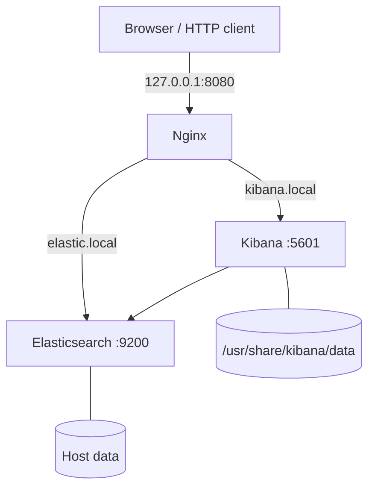

# Global Elasticsearch Stack

[](https://github.com/yaleksandr89/docker-elasticsearch)
[](https://www.elastic.co/elasticsearch)
[](https://www.elastic.co/kibana)
[](https://nginx.org/)
[](https://www.docker.com/)
[](https://github.com/yaleksandr89/docker-elasticsearch/actions/workflows/ci.yml)
[](../../../LICENSE.md)

## Choose language

| Русский | English | Español | 中文 | Français | Deutsch |
|---|---|---|---|---|---|
| [Русский](../../../README.md) | **Selected** | [Español](../es/README.md) | [中文](../zh/README.md) | [Français](../fr/README.md) | [Deutsch](../de/README.md) |

A local learning lab for Elasticsearch: indices, documents, full-text search, filters, aggregations and text analysis. Kibana provides Dev Tools and data exploration; Nginx routes HTTP requests to the appropriate service. No product database is preloaded: create the training index using the guide.

Use synthetic data only. Local processes, browsers and users with Docker access can reach this lab over unauthenticated HTTP. Keep it off public networks.

## Features

- Single-node Elasticsearch with a 2 GiB JVM heap; `analysis-icu` and `analysis-phonetic` are installed during the build.
- Kibana for queries and visual exploration; Nginx for two virtual hosts.
- A training mapping, a small synthetic dataset and Query DSL examples.
- A geographic synonym dictionary is included in the image; an analyzer must be configured explicitly.

## Lab architecture



In the local setup only Nginx is published to the host on loopback. Ports `9200` and `5601` are internal Compose-network ports; Elasticsearch stores indices in a host directory. Kibana connects to Elasticsearch inside the network, not via its public domain.

## Requirements

Git, GNU Make, Bash, curl, Docker Engine 28+ or Docker Desktop with Compose v2.14.2+. Linux, macOS or Windows with WSL2 is recommended. Initial builds need access to official registries, OS repositories and the plugin server, free disk space and at least 4 GiB available memory (6–8 GiB recommended); Elasticsearch uses a 2 GiB JVM heap and Kibana and Docker need additional memory.

## Quick start

```bash
git clone https://github.com/yaleksandr89/docker-elasticsearch.git
cd docker-elasticsearch
make init
make config
```

Before building, check the free port, Docker memory, project and three container names. In `make config` verify a single `backend` network and one publication at `127.0.0.1:8080`. Give a second checkout separate names, port and both data paths. Each image user needs write access to its directory.

Before building, read [Getting started](guides/getting-started.md).

```bash
docker compose ls -a
docker ps -a
ls -ld data/elasticsearch data/kibana
make build
make up
```

Compose starts Kibana in the background after the Elasticsearch HTTP health check succeeds. Check Kibana readiness at /api/status. Adjust example URLs for any custom domain or port. [Kibana](http://kibana.local:8080) · [Elasticsearch](http://elastic.local:8080)

```bash
curl --noproxy '*' --resolve elastic.local:8080:127.0.0.1 --fail --silent --show-error --max-time 10 http://elastic.local:8080/
curl --noproxy '*' --resolve kibana.local:8080:127.0.0.1 --fail --silent --show-error --max-time 10 http://kibana.local:8080/api/status
```

[Getting started](guides/getting-started.md) · [Search and text analysis exercises](guides/search-lab.md)

## Checks

CI runs for pushes and pull requests to `master`, and manually from Actions. `quality` checks startup script syntax, training fixtures and resolved Compose; `docker-smoke` builds an isolated lab with fixed versions and checks HTTP via both virtual hosts, plugins and training searches. CI results, not the presence of a workflow, establish whether it passed.

## Documentation

- [Getting started](guides/getting-started.md)
- [Search and text analysis exercises](guides/search-lab.md)
- [Operations and Make commands](guides/operations.md)
- [Troubleshooting](guides/troubleshooting.md)
- [Architecture and configuration](reference/configuration.md)
- [Contributing](CONTRIBUTING.md)

## Feedback

- Reproducible bugs: [GitHub Issues](https://github.com/yaleksandr89/docker-elasticsearch/issues).
- Questions and ideas: [GitHub Discussions](https://github.com/yaleksandr89/docker-elasticsearch/discussions).

---

<p align="center">
  If the project was useful, give it a star on GitHub so other developers can find it more easily.
</p>
