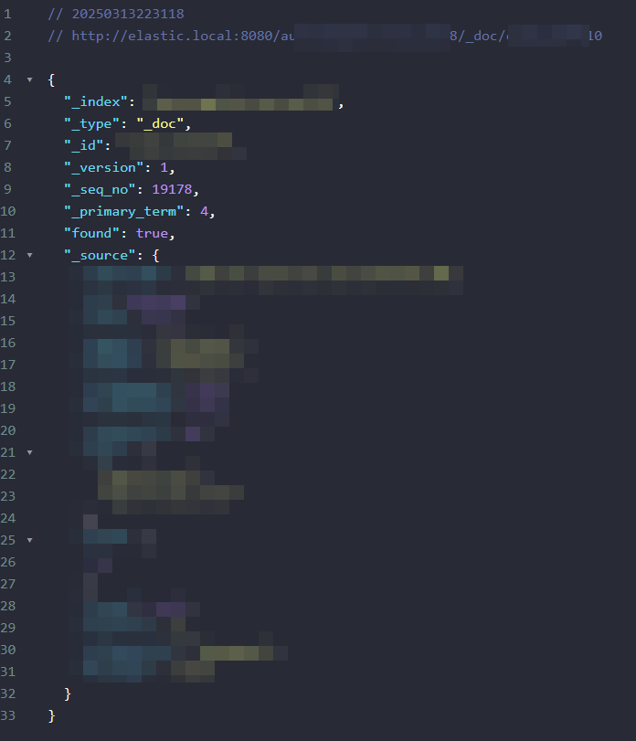
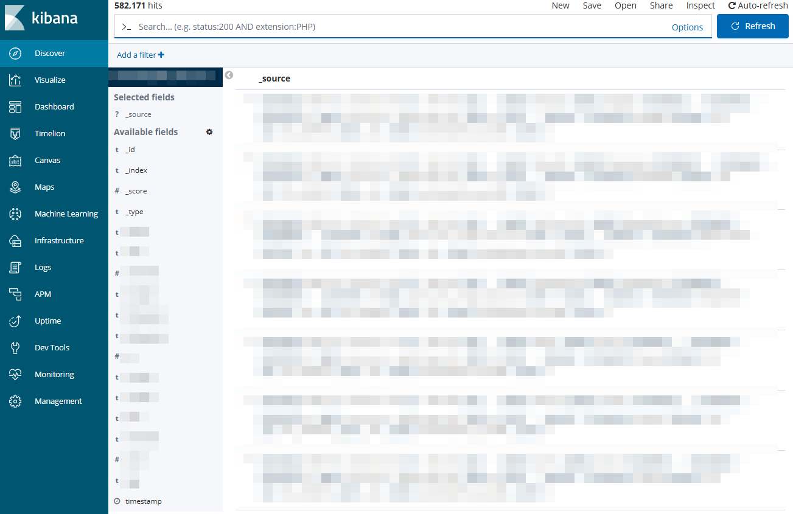

# Getting started

## Choose language

| Русский | English | Español | 中文 | Français | Deutsch |
|---|---|---|---|---|---|
| [Русский](../../ru/guides/getting-started.md) | **Selected** | [Español](../../es/guides/getting-started.md) | [中文](../../zh/guides/getting-started.md) | [Français](../../fr/guides/getting-started.md) | [Deutsch](../../de/guides/getting-started.md) |

A local learning lab for Elasticsearch: indices, documents, full-text search, filters, aggregations and text analysis. Kibana provides Dev Tools and data exploration; Nginx routes HTTP requests to the appropriate service. No product database is preloaded: create the training index using the guide.

Use synthetic data only. Local processes, browsers and users with Docker access can reach this lab over unauthenticated HTTP. Keep it off public networks.

## Requirements

Git, GNU Make, Bash, curl, Docker Engine 28+ or Docker Desktop with Compose v2.14.2+. Linux, macOS or Windows with WSL2 is recommended. Initial builds need access to official registries, OS repositories and the plugin server, free disk space and at least 4 GiB available memory (6–8 GiB recommended); Elasticsearch uses a 2 GiB JVM heap and Kibana and Docker need additional memory.

## Prepare the host

Check versions and available resources before starting. On Linux and the Linux environment used by Docker/WSL, check `vm.max_map_count`; the official guidance for current Elasticsearch is `1048576`. If it is lower and Elasticsearch reports a bootstrap check, configure the kernel actually running Docker using the [official instructions](https://www.elastic.co/docs/deploy-manage/deploy/self-managed/vm-max-map-count). Do not change host settings blindly. Docker Desktop allocates memory to its VM.

```bash
docker version
docker compose version
make --version
# Linux / WSL
sysctl vm.max_map_count
```

## Quick start

```bash
git clone https://github.com/yaleksandr89/docker-elasticsearch.git
cd docker-elasticsearch
make init
make config
```

Before building, check the free port, Docker memory, project and three container names. In `make config` verify a single `backend` network and one publication at `127.0.0.1:8080`. Give a second checkout separate names, port and both data paths. Each image user needs write access to its directory.

```bash
docker compose ls -a
docker ps -a
ls -ld data/elasticsearch data/kibana
make build
```

`make init` retains an existing `.docker.env` and creates missing directories. It leaves permissions as they are. The tested Elasticsearch user has UID 1000 and primary GID 0. Kibana has UID 1000, primary GID 1000 and supplementary group 0. These commands assume a fresh checkout with default settings on local Linux. Verify the paths in `make config`, the effective IDs, directory ownership and that both directories are empty.

```bash
docker run --rm --network none --read-only --entrypoint id docker-elasticsearch-elasticsearch
docker run --rm --network none --read-only --entrypoint id docker-elasticsearch-kibana
id
ls -ldn data/elasticsearch data/kibana
find data/elasticsearch data/kibana -mindepth 1 -maxdepth 1 -print
```

If the image UID differs from the owner’s and lacks access, the owner can grant access to these two new empty directories. Run the example only after confirming UID 1000 and the exact paths. It requires the optional `setfacl` and `getfacl` utilities and a local filesystem with POSIX ACLs. If unsupported, agree on a fresh writable location with the owner. Leave existing data directories alone.

```bash
setfacl -m u:1000:rwx -- data/elasticsearch data/kibana
getfacl -- data/elasticsearch data/kibana
```

```bash
make up
```

Compose starts Kibana in the background after the Elasticsearch HTTP health check succeeds. Check Kibana readiness at /api/status. Adjust example URLs for any custom domain or port. [Kibana](http://kibana.local:8080) · [Elasticsearch](http://elastic.local:8080)

## Connection and readiness

For the browser, add these two entries to the hosts file on the OS running the browser: Linux/macOS `/etc/hosts`, Windows `C:\Windows\System32\drivers\etc\hosts` (appropriate privileges are required). Curl does not require hosts changes: `--resolve` routes the request to loopback with the correct Host.

```text
127.0.0.1    elastic.local
127.0.0.1    kibana.local
```

```bash
curl --noproxy '*' --resolve elastic.local:8080:127.0.0.1 --fail --silent --show-error --max-time 10 http://elastic.local:8080/
curl --noproxy '*' --resolve elastic.local:8080:127.0.0.1 --fail --silent --show-error --max-time 10 'http://elastic.local:8080/_cluster/health?pretty'
curl --noproxy '*' --resolve elastic.local:8080:127.0.0.1 --fail --silent --show-error --max-time 10 'http://elastic.local:8080/_cat/plugins?v'
curl --noproxy '*' --resolve kibana.local:8080:127.0.0.1 --fail --silent --show-error --max-time 10 http://kibana.local:8080/api/status
```

The Elasticsearch root response contains `version.number` and `cluster_name`; `_cluster/health` reports status. `green` means all shards are available, `yellow` on one node may mean unassigned replicas, and `red` requires investigation. Both plugins should appear in `_cat/plugins`. Kibana is ready when `/api/status` reports `status.overall.level: available`; 502/503 may occur before that. Then open [Kibana](http://kibana.local:8080) and Dev Tools → Console.

[Startup troubleshooting](troubleshooting.md) · [Search and text analysis exercises](search-lab.md)

## Historical screenshots

Original illustrations of the earlier lab (Elasticsearch 6.8.0) are preserved. Current versions differ in layout, menus and responses; these images do not verify a current run.








## Documentation

- [Search and text analysis exercises](search-lab.md)
- [Operations and Make commands](operations.md)
- [Troubleshooting](troubleshooting.md)
- [Architecture and configuration](../reference/configuration.md)
- [Contributing](../CONTRIBUTING.md)
