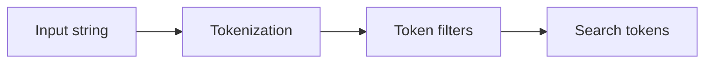

# Search and text analysis exercises

## Choose language

| Русский | English | Español | 中文 | Français | Deutsch |
|---|---|---|---|---|---|
| [Русский](../../ru/guides/search-lab.md) | **Selected** | [Español](../../es/guides/search-lab.md) | [中文](../../zh/guides/search-lab.md) | [Français](../../fr/guides/search-lab.md) | [Deutsch](../../de/guides/search-lab.md) |

Goal: create a separate training index, understand `text` versus `keyword`, and compare Query DSL, analyzers and aggregations. Run only in the isolated local lab from the guide. The data is synthetic, IDs 1–3. Results below are expected outcomes, not a recorded execution.

[Getting started](getting-started.md)

## Create the index and load data

[`products-index.json`](../../../examples/products-index.json) · [`products.ndjson`](../../../examples/products.ndjson)

Mapping describes field types. `title` is analyzed text with a separate synonym search analyzer; `title.folded` is a multi-field for Unicode folding, `brand.sound` a phonetic multi-field, `category` an exact value for filters/aggregations, `price` a number and `in_stock` a boolean. The index uses one primary shard and zero replicas for single-node practice.

From the repository root, verify that `es-lab-products` does not exist (HTTP 404). If it exists, do not overwrite someone else’s documents: verify ownership first. `PUT` creates the index with explicit mapping; `_bulk` accepts NDJSON ending with a newline. `refresh=wait_for` waits until records are searchable. Check `acknowledged: true`, `errors: false` in bulk and a count of 3.

```bash
es() {
    curl --noproxy '*' --resolve elastic.local:8080:127.0.0.1 --fail --silent --show-error --max-time 30 "$@"
}
status=$(curl --noproxy '*' --resolve elastic.local:8080:127.0.0.1 --silent --show-error --max-time 10 --head --output /dev/null --write-out '%{http_code}' http://elastic.local:8080/es-lab-products)
test "$status" = 404
```

```bash
test "$status" = 404 && es -X PUT -H 'Content-Type: application/json' --data-binary @docs/examples/products-index.json http://elastic.local:8080/es-lab-products
```

Continue only after `acknowledged: true`; stop if index creation fails. Bulk uses `create`: a repeated load cannot overwrite existing IDs, but partial failures are possible (inspect `errors` and `items`).

```bash
es -X POST -H 'Content-Type: application/x-ndjson' --data-binary @docs/examples/products.ndjson 'http://elastic.local:8080/es-lab-products/_bulk?refresh=wait_for'
es 'http://elastic.local:8080/es-lab-products/_count?pretty'
```

## Query DSL: search, filters and aggregations

Execute the following blocks one at a time in Kibana Dev Tools → Console. Inspect `hits.hits` (documents), `_score` (relevance score) and `aggregations`. The order of equally scored results is not guaranteed.

`match` analyzes the query. The search synonym `laptop, notebook` should return documents 1 and 2.

```http
GET es-lab-products/_search
{"query":{"match":{"title":"laptop"}}}
```

`term` matches an exact `keyword` without analyzing the string. Expect documents 1 and 2. A `term` query on `text` is not a substitute for full-text `match`.

```http
GET es-lab-products/_search
{"query":{"term":{"category":"computers"}}}
```

`bool.must` contributes to relevance, while `filter` restricts results without scoring. For in-stock laptops costing at most 1000, expect only document 1.

```http
GET es-lab-products/_search
{
  "query": {
    "bool": {
      "must": {"match": {"title": "laptop"}},
      "filter": [
        {"term": {"in_stock": true}},
        {"range": {"price": {"lte": 1000}}}
      ]
    }
  }
}
```

`terms` groups by `category`. With `size: 0` only metadata and aggregations are returned: expect `computers: 2`, `audio: 1`.

```http
GET es-lab-products/_search
{"size":0,"aggs":{"categories":{"terms":{"field":"category"}}}}
```

## How text analysis works



An analyzer turns a string into tokens. Index-time tokens populate the inverted index; search-time tokens are used for matching. `_analyze` shows the result without adding a document. Search-time synonyms expand the query without changing the original `_source`.

```http
POST es-lab-products/_analyze
{"analyzer":"lab_search","text":"laptop"}
```

ICU folding normalizes Unicode, including diacritics. Compare tokens for `Café` and `cafe`, then search `title.folded`: expect document 3. This is not universal translation between languages.

```http
POST es-lab-products/_analyze
{"analyzer":"lab_icu","text":["Café","cafe"]}

GET es-lab-products/_search
{"query":{"match":{"title.folded":"cafe"}}}
```

Double Metaphone encodes sound. `Smith` and `Smyth` should match `brand.sound` (1 and 2). The normal `brand` field remains for separate search: phonetic matching can produce false positives and depends on language.

```http
POST es-lab-products/_analyze
{"analyzer":"lab_sound","text":["Smith","Smyth"]}

GET es-lab-products/_search
{"query":{"match":{"brand.sound":"Smith"}}}
```

The project dictionary `analysis/synonyms.txt` is copied into Elasticsearch configuration at build time but is not automatically attached to the standard analyzer. Test it explicitly with `_analyze`; expect `россия` among tokens for `russia`. It contains geographic name variants, is not a general language dictionary and may need editorial review. For multi-word synonyms use `synonym_graph` at search time. Editing the file requires rebuilding the image and appropriately applying analyzer changes; it does not automatically reindex data.

```http
POST /_analyze
{
  "tokenizer": "standard",
  "filter": ["lowercase", {"type":"synonym_graph","synonyms_path":"analysis/synonyms.txt"}],
  "text": "russia"
}
```

## Kibana Discover

In Kibana Discover, create a data view for `es-lab-products` without a time field (the mapping has no timestamp). Open documents, add `category`, `price`, `in_stock` and compare filters with Query DSL. Menu labels may differ by Kibana version.

## Finish the exercise

Keep the index for further queries. If you are certain you created it in this disposable lab and no longer need it, the following command deletes all its documents and mapping without automatic recovery. Do not use wildcards or run it on another cluster.

```http
DELETE es-lab-products
```

## Official documentation

- [Match query](https://www.elastic.co/docs/reference/query-languages/query-dsl/query-dsl-match-query)
- [ICU analysis](https://www.elastic.co/docs/reference/elasticsearch/plugins/analysis-icu)
- [Phonetic filter](https://www.elastic.co/docs/reference/elasticsearch/plugins/analysis-phonetic-token-filter)
- [Synonym graph](https://www.elastic.co/docs/reference/text-analysis/analysis-synonym-graph-tokenfilter)

## Documentation

- [Getting started](getting-started.md)
- [Operations and Make commands](operations.md)
- [Troubleshooting](troubleshooting.md)
- [Architecture and configuration](../reference/configuration.md)
- [Contributing](../CONTRIBUTING.md)
