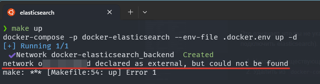

# Troubleshooting

## Choose language

| Русский | English | Español | 中文 | Français | Deutsch |
|---|---|---|---|---|---|
| [Русский](../../ru/guides/troubleshooting.md) | **Selected** | [Español](../../es/guides/troubleshooting.md) | [中文](../../zh/guides/troubleshooting.md) | [Français](../../fr/guides/troubleshooting.md) | [Deutsch](../../de/guides/troubleshooting.md) |

Start with the resolved configuration, container state and logs. Remove credentials, tokens, data and internal names before sharing output. These commands use local mode. For integration, add `WITH_EXTERNAL_NETWORK=1` to each Make call and `-f docker-compose.external.yml` to Compose.

[Getting started](getting-started.md)

```bash
make config
docker compose --env-file .docker.env -f docker-compose.yml ps -a
make log elasticsearch
make log kibana
make log nginx
```

## External network error

A missing external network can fail startup only in opt-in mode. Compare `EXTERNAL_NETWORK` with `docker network ls`, then run `docker network inspect` with its actual name. Confirm membership with the application owner. Leave other projects’ networks alone. The screenshot below is historical (6.8).

```bash
docker network ls
```

 (6.8)

## Ports, domains and 502/503

If the port is busy, pick a free `NGINX_PORT` and update all URLs and `--resolve` arguments. Internal ports 9200 and 5601 are fixed. If curl works but the browser fails, check the browser host’s hosts file and proxy bypass for both domains. An unknown Host returns HTTP 404. For 502/503, inspect the upstream state and logs. Compose waits for a bounded Elasticsearch HTTP health check. Kibana is ready when `/api/status` reports `status.overall.level: available`. If the Elasticsearch check exhausts retries, diagnose its logs first. Apply image changes with `make build` and configuration with `make up`, or use `down` then `up` with the same mounts. `restart` retains the current configuration.

```bash
curl --noproxy '*' --resolve elastic.local:8080:127.0.0.1 --fail --silent --show-error --max-time 10 http://elastic.local:8080/
curl --noproxy '*' --resolve elastic.local:8080:127.0.0.1 --fail --silent --show-error --max-time 10 'http://elastic.local:8080/_cluster/health?pretty'
curl --noproxy '*' --resolve elastic.local:8080:127.0.0.1 --fail --silent --show-error --max-time 10 'http://elastic.local:8080/_cat/plugins?v'
curl --noproxy '*' --resolve kibana.local:8080:127.0.0.1 --fail --silent --show-error --max-time 10 http://kibana.local:8080/api/status
```

## Builds, plugins and resources

For build failures, check access to the official registries and plugin downloads. Elasticsearch and Kibana versions must match. `_cat/plugins` should show `analysis-icu` and `analysis-phonetic` at that same version. For startup errors, check disk space, Docker memory, OOM reports, `vm.max_map_count` and [permissions for both UID/GID pairs](getting-started.md) on the actual paths. For analyzer errors, read the API response and check `config/analysis/synonyms.txt`. Investigate invalid rules before changing analyzer behavior with `lenient`.

## Documentation

- [Getting started](getting-started.md)
- [Search and text analysis exercises](search-lab.md)
- [Operations and Make commands](operations.md)
- [Architecture and configuration](../reference/configuration.md)
- [Contributing](../CONTRIBUTING.md)
