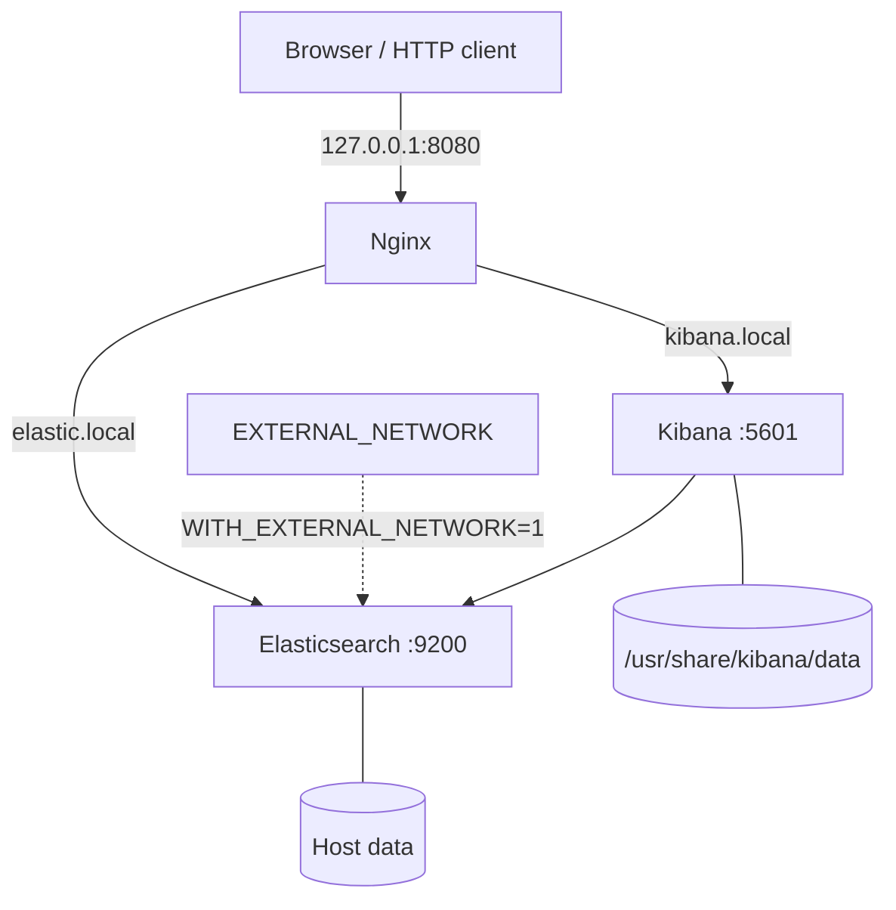

# Architecture and configuration

## Choose language

| Русский | English | Español | 中文 | Français | Deutsch |
|---|---|---|---|---|---|
| [Русский](../../ru/reference/configuration.md) | **Selected** | [Español](../../es/reference/configuration.md) | [中文](../../zh/reference/configuration.md) | [Français](../../fr/reference/configuration.md) | [Deutsch](../../de/reference/configuration.md) |

Make reads `.docker.env` as trusted local configuration. Preserve existing settings and verify the upgrade path before starting with prior data. Direct Compose calls require the same exact versions, distinct names and fixed upstream ports.

[`.docker.env.example`](../../../../.docker.env.example) · [`docker-compose.yml`](../../../../docker-compose.yml) · [`docker-compose.external.yml`](../../../../docker-compose.external.yml) · [`docker-configs/elasticsearch/elasticsearch.yml`](../../../../docker-configs/elasticsearch/elasticsearch.yml) · [`docker-configs/kibana/Dockerfile`](../../../../docker-configs/kibana/Dockerfile) · [`docker-configs/nginx/default.conf.template`](../../../../docker-configs/nginx/default.conf.template)

Use synthetic data only. Local processes, browsers and users with Docker access can reach this lab over unauthenticated HTTP. Keep it off public networks.

## Services and access boundaries



In the local setup only Nginx is published to the host on loopback. Ports `9200` and `5601` are internal Compose-network ports; Elasticsearch stores indices in a host directory. Kibana connects to Elasticsearch inside the network, not via its public domain.

`cluster.name: custom-cluster` · `discovery.type=single-node` · `ES_JAVA_OPTS=-Xms2048m -Xmx2048m` · `xpack.security.enabled: false`.

Compose starts Kibana in the background after the Elasticsearch HTTP health check succeeds. Check Kibana readiness at /api/status. Adjust example URLs for any custom domain or port.

Kibana: `kibana-docker`, `ELASTICSEARCH_HOSTS=["http://elasticsearch:9200"]`, `SERVER_PUBLICBASEURL=http://${KIBANA_DOMAIN}:${NGINX_PORT}`. Nginx: `/etc/nginx/templates/default.conf.template` → `/etc/nginx/conf.d/default.conf`, `default_server` → HTTP 404. Nginx refreshes upstream addresses through Docker’s embedded DNS. Within `backend` it uses the service names `elasticsearch` and `kibana`.

## Environment variables

| Variable | Default | Purpose |
|---|---|---|
| `COMPOSE_PROJECT_NAME` | `docker-elasticsearch` | Compose project name. |
| `ELASTIC_VERSION` | `9.5.7` | Official Elasticsearch base image tag. |
| `KIBANA_VERSION` | `9.5.7` | Kibana tag; must match Elasticsearch. |
| `NGINX_VERSION` | `1.30.8-trixie` | `nginx:${NGINX_VERSION}` |
| `ELASTIC_CONTAINER` | `docker-elasticsearch-es` | Explicit container name; must be unique on the Docker host. |
| `KIBANA_CONTAINER` | `docker-elasticsearch-kibana` | Explicit container name; must be unique on the Docker host. |
| `NGINX_CONTAINER` | `docker-elasticsearch-nginx` | Explicit container name; must be unique on the Docker host. |
| `KIBANA_DOMAIN` | `kibana.local` | Nginx virtual host name; use a trusted local name. |
| `ELASTIC_DOMAIN` | `elastic.local` | Nginx virtual host name; use a trusted local name. |
| `KIBANA_PORT` | `5601` | Internal upstream port, not published on host. |
| `ELASTIC_PORT` | `9200` | Internal upstream port, not published on host. |
| `NGINX_PORT` | `8080` | Nginx host port on `127.0.0.1`. |
| `ELASTIC_DATA_DIR` | `./data/elasticsearch` | Bind mount for `/usr/share/elasticsearch/data`; persists indices. |
| `KIBANA_DATA_DIR` | `./data/kibana` | → `/usr/share/kibana/data` |
| `EXTERNAL_NETWORK` | `external_network` | `WITH_EXTERNAL_NETWORK=1` |
| `WITH_EXTERNAL_NETWORK` | `0` | Make option. `0` selects local mode and `1` adds the extension. |

## Integration with another project

Find the application’s existing trusted network with `docker network ls` and check its members with `docker network inspect`. Set its actual name as `EXTERNAL_NETWORK` in `.docker.env`. Compose merges the base and extension, keeps `backend`, and attaches only Elasticsearch to the extra network. From the application container use `http://docker-elasticsearch-es:9200` or the actual `ELASTIC_CONTAINER` name. All network members get unauthenticated access. Keep the flag on subsequent commands, including shutdown.

```bash
docker network ls
make config WITH_EXTERNAL_NETWORK=1
make up WITH_EXTERNAL_NETWORK=1
```

```bash
make down WITH_EXTERNAL_NETWORK=1
```

To switch modes, run `down` with the old file set or flag, keep both data paths, then run `up` with the new setting. The external network remains with its owner. Use only the agreed network and data paths. `restart` retains the existing container network settings.

```bash
docker compose --env-file .docker.env -f docker-compose.yml -f docker-compose.external.yml config
docker compose --env-file .docker.env -f docker-compose.yml -f docker-compose.external.yml up -d
docker compose --env-file .docker.env -f docker-compose.yml -f docker-compose.external.yml down
```

## Persistence and upgrades

Both bind mounts survive recreation. Kibana stores most saved objects in Elasticsearch system indices. Before stopping the old stack, inspect `/usr/share/kibana/data` in its container and save any needed container-local files separately.

[Snapshots and upgrades](../guides/operations.md)

## Documentation

- [Getting started](../guides/getting-started.md)
- [Search and text analysis exercises](../guides/search-lab.md)
- [Operations and Make commands](../guides/operations.md)
- [Troubleshooting](../guides/troubleshooting.md)
- [Contributing](../CONTRIBUTING.md)
