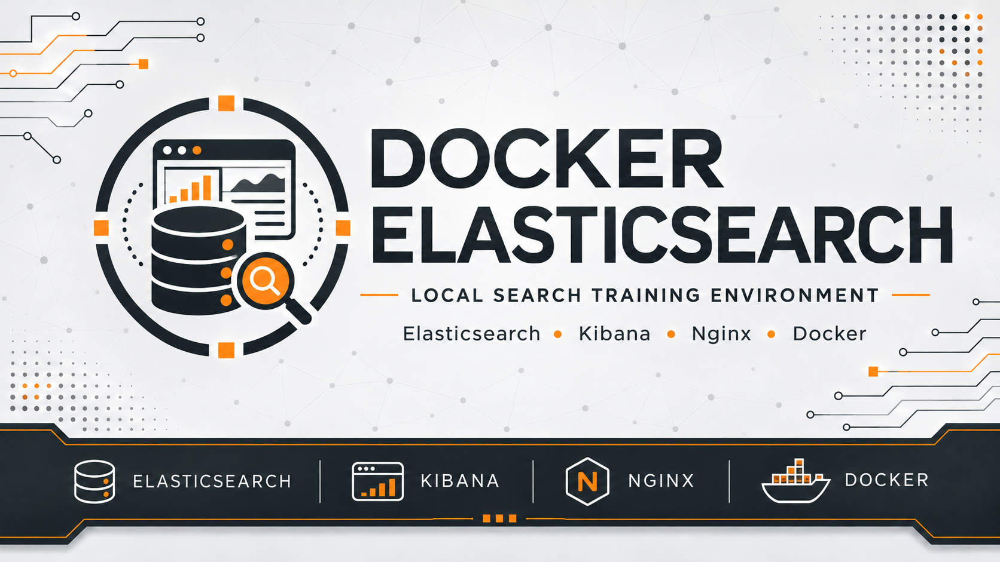
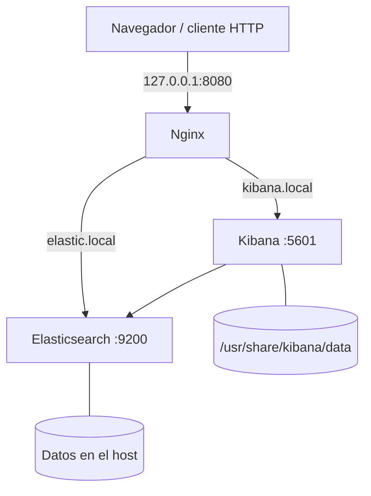

# Global Elasticsearch Stack

[](https://github.com/yaleksandr89/docker-elasticsearch)
[](https://www.elastic.co/elasticsearch)
[](https://www.elastic.co/kibana)
[](https://nginx.org/)
[](https://www.docker.com/)
[](https://github.com/yaleksandr89/docker-elasticsearch/actions/workflows/ci.yml)
[](../../../LICENSE.md)



## Elegir idioma

| Русский | English | Español | 中文 | Français | Deutsch |
|---|---|---|---|---|---|
| [Русский](../../../README.md) | [English](../en/README.md) | **Seleccionado** | [中文](../zh/README.md) | [Français](../fr/README.md) | [Deutsch](../de/README.md) |

Un laboratorio local para aprender Elasticsearch: índices, documentos, búsqueda de texto completo, filtros, agregaciones y análisis de texto. Kibana permite ejecutar consultas en Dev Tools y explorar los datos; Nginx dirige las solicitudes HTTP al servicio correspondiente. No hay una base de productos precargada: cree el índice de prácticas siguiendo la guía.

Use solo datos sintéticos. Los procesos locales, el navegador y los usuarios de Docker pueden acceder por HTTP sin autenticación. No publique el laboratorio en Internet.

## Funciones

- Elasticsearch de un nodo con heap JVM de 2 GiB; `analysis-icu` y `analysis-phonetic` se instalan durante la construcción.
- Kibana para consultas y exploración visual; Nginx para dos hosts virtuales.
- Un mapping de prácticas, un conjunto pequeño de datos sintéticos y ejemplos de Query DSL.
- La imagen incluye un diccionario de sinónimos geográficos; el analizador debe configurarse explícitamente.

## Arquitectura del laboratorio



En el modo local, solo Nginx se publica en el host por loopback. Los puertos `9200` y `5601` son internos a la red Compose; Elasticsearch guarda los índices en un directorio del host. Kibana conecta con Elasticsearch dentro de la red, no por el dominio público.

## Requisitos

Git, GNU Make, Bash, curl, Docker Engine 28+ o Docker Desktop con Compose v2.14.2+. Se recomienda Linux, macOS o Windows con WSL2. La primera construcción requiere acceso a registros oficiales, repositorios del sistema y servidor de plugins, espacio libre y al menos 4 GiB de memoria disponible (preferiblemente 6–8 GiB); Elasticsearch usa 2 GiB de heap JVM y Kibana y Docker necesitan memoria adicional.

## Inicio rápido

```bash
git clone https://github.com/yaleksandr89/docker-elasticsearch.git
cd docker-elasticsearch
make init
make config
```

Antes de construir, compruebe el puerto libre, la memoria de Docker y los nombres del proyecto y los tres contenedores. En `make config` debe aparecer solo la red `backend` y una publicación en `127.0.0.1:8080`. Para otra copia cambie los nombres, el puerto y ambos directorios. Cada usuario de imagen necesita escritura en su directorio.

Antes de construir, lea [Primeros pasos](guides/getting-started.md).

```bash
docker compose ls -a
docker ps -a
ls -ld data/elasticsearch data/kibana
make build
make up
```

Compose inicia Kibana en segundo plano tras la comprobación HTTP de Elasticsearch. Revise /api/status para confirmar que Kibana está listo. Adapte las URL al dominio y puerto elegidos. [Kibana](http://kibana.local:8080) · [Elasticsearch](http://elastic.local:8080)

```bash
curl --noproxy '*' --resolve elastic.local:8080:127.0.0.1 --fail --silent --show-error --max-time 10 http://elastic.local:8080/
curl --noproxy '*' --resolve kibana.local:8080:127.0.0.1 --fail --silent --show-error --max-time 10 http://kibana.local:8080/api/status
```

[Primeros pasos](guides/getting-started.md) · [Práctica de búsqueda y análisis de texto](guides/search-lab.md)

## Comprobaciones

CI se ejecuta para push y pull request a `master` y manualmente desde Actions. `quality` comprueba sintaxis de scripts, fixtures y Compose resuelto; `docker-smoke` construye un laboratorio aislado con versiones fijas y comprueba HTTP por ambos hosts virtuales, plugins y búsqueda. Solo los resultados CI confirman el éxito.

## Documentación

- [Primeros pasos](guides/getting-started.md)
- [Práctica de búsqueda y análisis de texto](guides/search-lab.md)
- [Operación y comandos Make](guides/operations.md)
- [Diagnóstico](guides/troubleshooting.md)
- [Arquitectura y configuración](reference/configuration.md)
- [Contribuir](CONTRIBUTING.md)

## Comentarios y soporte

- Errores reproducibles: [GitHub Issues](https://github.com/yaleksandr89/docker-elasticsearch/issues).
- Preguntas e ideas: [GitHub Discussions](https://github.com/yaleksandr89/docker-elasticsearch/discussions).
- Vulnerabilidades: [política de seguridad](SECURITY.md).

---

<p align="center">
  Si el proyecto te resultó útil, dale una estrella en GitHub para que otros desarrolladores puedan encontrarlo más fácilmente. 🤘
</p>
