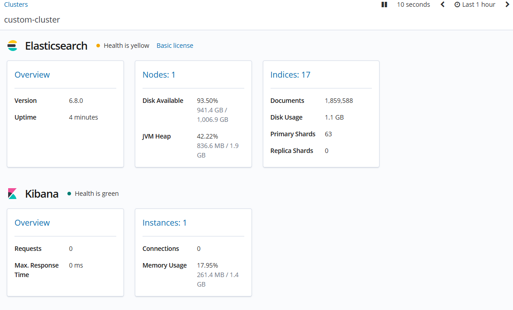
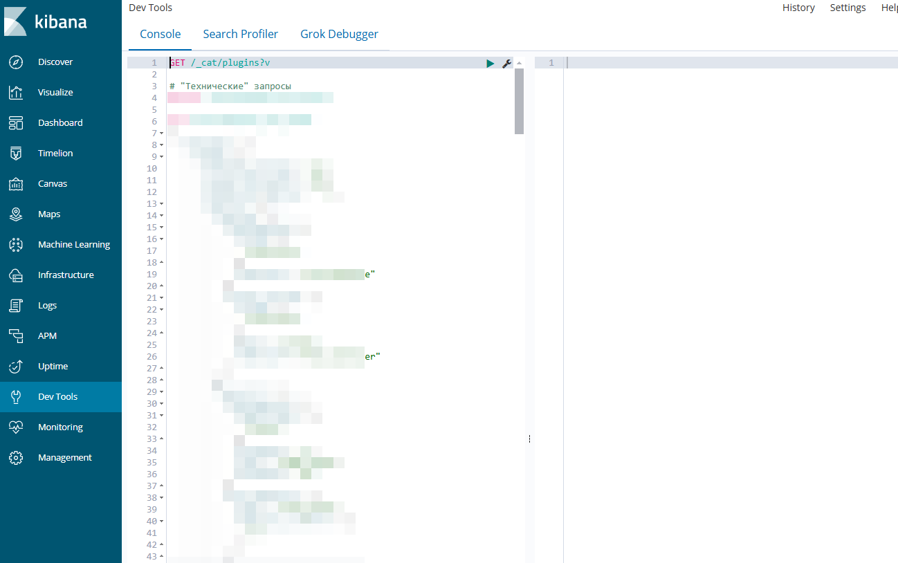

# Primeros pasos

## Elegir idioma

| Русский | English | Español | 中文 | Français | Deutsch |
|---|---|---|---|---|---|
| [Русский](../../ru/guides/getting-started.md) | [English](../../en/guides/getting-started.md) | **Seleccionado** | [中文](../../zh/guides/getting-started.md) | [Français](../../fr/guides/getting-started.md) | [Deutsch](../../de/guides/getting-started.md) |

Un laboratorio local para aprender Elasticsearch: índices, documentos, búsqueda de texto completo, filtros, agregaciones y análisis de texto. Kibana permite ejecutar consultas en Dev Tools y explorar los datos; Nginx dirige las solicitudes HTTP al servicio correspondiente. No hay una base de productos precargada: cree el índice de prácticas siguiendo la guía.

Use solo datos sintéticos. Los procesos locales, el navegador y los usuarios de Docker pueden acceder por HTTP sin autenticación. No publique el laboratorio en Internet.

## Requisitos

Git, GNU Make, Bash, curl, Docker Engine 28+ o Docker Desktop con Compose v2.14.2+. Se recomienda Linux, macOS o Windows con WSL2. La primera construcción requiere acceso a registros oficiales, repositorios del sistema y servidor de plugins, espacio libre y al menos 4 GiB de memoria disponible (preferiblemente 6–8 GiB); Elasticsearch usa 2 GiB de heap JVM y Kibana y Docker necesitan memoria adicional.

## Preparar el host

Compruebe versiones y recursos antes de arrancar. En Linux y el entorno Linux usado por Docker/WSL, compruebe `vm.max_map_count`; la recomendación oficial para Elasticsearch actual es `1048576`. Si es menor y Elasticsearch informa de un bootstrap check, configure el kernel que realmente ejecuta Docker según las [instrucciones oficiales](https://www.elastic.co/docs/deploy-manage/deploy/self-managed/vm-max-map-count). No cambie el host a ciegas. Docker Desktop asigna memoria a su VM.

```bash
docker version
docker compose version
make --version
# Linux / WSL
sysctl vm.max_map_count
```

## Inicio rápido

```bash
git clone https://github.com/yaleksandr89/docker-elasticsearch.git
cd docker-elasticsearch
make init
make config
```

Antes de construir, compruebe el puerto libre, la memoria de Docker y los nombres del proyecto y los tres contenedores. En `make config` debe aparecer solo la red `backend` y una publicación en `127.0.0.1:8080`. Para otra copia cambie los nombres, el puerto y ambos directorios. Cada usuario de imagen necesita escritura en su directorio.

```bash
docker compose ls -a
docker ps -a
ls -ld data/elasticsearch data/kibana
make build
```

`make init` conserva el `.docker.env` existente y crea los directorios que faltan. Mantiene sus permisos. El usuario de Elasticsearch tiene UID 1000 y GID principal 0. Kibana tiene UID 1000, GID principal 1000 y grupo suplementario 0. Use estos comandos en una copia nueva con valores predeterminados en Linux local. Compruebe las rutas en `make config`, los ID efectivos, el propietario y que ambos directorios estén vacíos.

```bash
docker run --rm --network none --read-only --entrypoint id docker-elasticsearch-elasticsearch
docker run --rm --network none --read-only --entrypoint id docker-elasticsearch-kibana
id
ls -ldn data/elasticsearch data/kibana
find data/elasticsearch data/kibana -mindepth 1 -maxdepth 1 -print
```

Si el UID de la imagen difiere del propietario y carece de acceso, el propietario puede concederlo a estos dos directorios nuevos y vacíos. Use el ejemplo tras confirmar el UID 1000 y las rutas exactas. Requiere las utilidades opcionales `setfacl` y `getfacl` y un sistema de archivos local con ACL POSIX. Si no están disponibles, acuerde con el propietario una ubicación nueva con escritura. Respete los directorios existentes.

```bash
setfacl -m u:1000:rwx -- data/elasticsearch data/kibana
getfacl -- data/elasticsearch data/kibana
```

```bash
make up
```

Compose inicia Kibana en segundo plano tras la comprobación HTTP de Elasticsearch. Revise /api/status para confirmar que Kibana está listo. Adapte las URL al dominio y puerto elegidos. [Kibana](http://kibana.local:8080) · [Elasticsearch](http://elastic.local:8080)

## Conexión y disponibilidad

Para el navegador, añada estas dos entradas al archivo hosts del sistema donde se ejecuta: Linux/macOS `/etc/hosts`, Windows `C:\Windows\System32\drivers\etc\hosts` (se requieren permisos adecuados). Curl no necesita cambiar hosts: `--resolve` dirige la solicitud a loopback con el Host correcto.

```text
127.0.0.1    elastic.local
127.0.0.1    kibana.local
```

```bash
curl --noproxy '*' --resolve elastic.local:8080:127.0.0.1 --fail --silent --show-error --max-time 10 http://elastic.local:8080/
curl --noproxy '*' --resolve elastic.local:8080:127.0.0.1 --fail --silent --show-error --max-time 10 'http://elastic.local:8080/_cluster/health?pretty'
curl --noproxy '*' --resolve elastic.local:8080:127.0.0.1 --fail --silent --show-error --max-time 10 'http://elastic.local:8080/_cat/plugins?v'
curl --noproxy '*' --resolve kibana.local:8080:127.0.0.1 --fail --silent --show-error --max-time 10 http://kibana.local:8080/api/status
```

La respuesta raíz de Elasticsearch contiene `version.number` y `cluster_name`; `_cluster/health` indica el estado. `green` indica todos los shards disponibles, `yellow` en un nodo puede indicar réplicas sin asignar y `red` exige diagnóstico. Ambos plugins deben aparecer en `_cat/plugins`. Kibana está lista cuando `/api/status` muestra `status.overall.level: available`; antes puede devolver 502/503. Abra [Kibana](http://kibana.local:8080) y Dev Tools → Console.

[Diagnóstico de arranque](troubleshooting.md) · [Práctica de búsqueda y análisis de texto](search-lab.md)

## Capturas históricas

Se conservan las ilustraciones originales del laboratorio anterior (Elasticsearch 6.8.0). Las versiones actuales difieren en aspecto, menús y respuestas; estas imágenes no verifican una ejecución actual.







## Documentación

- [Práctica de búsqueda y análisis de texto](search-lab.md)
- [Operación y comandos Make](operations.md)
- [Diagnóstico](troubleshooting.md)
- [Arquitectura y configuración](../reference/configuration.md)
- [Contribuir](../CONTRIBUTING.md)
