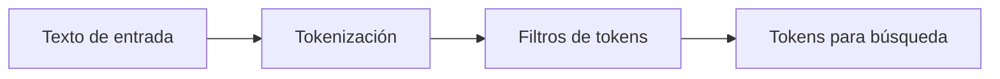

# Práctica de búsqueda y análisis de texto

## Elegir idioma

| Русский | English | Español | 中文 | Français | Deutsch |
|---|---|---|---|---|---|
| [Русский](../../ru/guides/search-lab.md) | [English](../../en/guides/search-lab.md) | **Seleccionado** | [中文](../../zh/guides/search-lab.md) | [Français](../../fr/guides/search-lab.md) | [Deutsch](../../de/guides/search-lab.md) |

Objetivo: crear un índice de prácticas separado, distinguir `text` de `keyword` y comparar Query DSL, analizadores y agregaciones. Ejecute solo en el laboratorio local aislado de la guía. Los datos son sintéticos, IDs 1–3. Los resultados son los esperados, no una ejecución registrada.

[Primeros pasos](getting-started.md)

## Crear el índice y cargar datos

[`products-index.json`](../../../examples/products-index.json) · [`products.ndjson`](../../../examples/products.ndjson)

El mapping describe los tipos de campo. `title` es texto analizado con analizador de sinónimos en búsqueda; `title.folded` es un multifield para folding Unicode, `brand.sound` uno fonético, `category` un valor exacto para filtros/agregaciones, `price` un número e `in_stock` un booleano. Un shard primario y cero réplicas para practicar en un nodo.

Desde la raíz del repositorio, compruebe que `es-lab-products` no existe (HTTP 404). Si existe, no sobrescriba documentos ajenos: verifique su pertenencia primero. `PUT` crea el índice con mapping explícito; `_bulk` recibe NDJSON con salto de línea final. `refresh=wait_for` espera a que los registros sean visibles para búsqueda. Compruebe `acknowledged: true`, `errors: false` en bulk y un total de 3.

```bash
es() {
    curl --noproxy '*' --resolve elastic.local:8080:127.0.0.1 --fail --silent --show-error --max-time 30 "$@"
}
status=$(curl --noproxy '*' --resolve elastic.local:8080:127.0.0.1 --silent --show-error --max-time 10 --head --output /dev/null --write-out '%{http_code}' http://elastic.local:8080/es-lab-products)
test "$status" = 404
```

```bash
test "$status" = 404 && es -X PUT -H 'Content-Type: application/json' --data-binary @docs/examples/products-index.json http://elastic.local:8080/es-lab-products
```

Continúe solo tras `acknowledged: true`; pare si falla la creación del índice. Bulk usa `create`: repetir la carga no sobrescribe IDs existentes, pero puede haber errores parciales (revise `errors` e `items`).

```bash
es -X POST -H 'Content-Type: application/x-ndjson' --data-binary @docs/examples/products.ndjson 'http://elastic.local:8080/es-lab-products/_bulk?refresh=wait_for'
es 'http://elastic.local:8080/es-lab-products/_count?pretty'
```

## Query DSL: búsqueda, filtros y agregaciones

Ejecute los siguientes bloques uno a uno en Kibana Dev Tools → Console. Revise `hits.hits` (documentos), `_score` (relevancia) y `aggregations`. No se garantiza el orden de resultados con igual puntuación.

`match` analiza la consulta. El sinónimo de búsqueda `laptop, notebook` debe devolver 1 y 2.

```http
GET es-lab-products/_search
{"query":{"match":{"title":"laptop"}}}
```

`term` coincide con un `keyword` exacto sin analizar la cadena. Se esperan 1 y 2. `term` en `text` no sustituye a `match`.

```http
GET es-lab-products/_search
{"query":{"term":{"category":"computers"}}}
```

`bool.must` aporta relevancia y `filter` limita resultados sin puntuar. Para portátiles disponibles de precio máximo 1000 se espera solo 1.

```http
GET es-lab-products/_search
{
  "query": {
    "bool": {
      "must": {"match": {"title": "laptop"}},
      "filter": [
        {"term": {"in_stock": true}},
        {"range": {"price": {"lte": 1000}}}
      ]
    }
  }
}
```

`terms` agrupa por `category`. Con `size: 0` se devuelven metadatos y agregaciones: `computers: 2`, `audio: 1`.

```http
GET es-lab-products/_search
{"size":0,"aggs":{"categories":{"terms":{"field":"category"}}}}
```

## Cómo funciona el análisis de texto



Un analizador convierte texto en tokens. Al indexar se guardan en el índice invertido; al buscar se usan para coincidencias. `_analyze` muestra el resultado sin añadir documentos. Los sinónimos en búsqueda amplían la consulta sin modificar `_source`.

```http
POST es-lab-products/_analyze
{"analyzer":"lab_search","text":"laptop"}
```

ICU folding normaliza Unicode, incluidos diacríticos. Compare tokens de `Café` y `cafe`, después busque `title.folded`: se espera 3. No traduce universalmente entre idiomas.

```http
POST es-lab-products/_analyze
{"analyzer":"lab_icu","text":["Café","cafe"]}

GET es-lab-products/_search
{"query":{"match":{"title.folded":"cafe"}}}
```

Double Metaphone codifica el sonido. `Smith` y `Smyth` deben coincidir por `brand.sound` (1 y 2). Se conserva `brand` para búsqueda normal: la fonética puede dar falsos positivos y depende del idioma.

```http
POST es-lab-products/_analyze
{"analyzer":"lab_sound","text":["Smith","Smyth"]}

GET es-lab-products/_search
{"query":{"match":{"brand.sound":"Smith"}}}
```

El diccionario `analysis/synonyms.txt` se copia a la configuración de Elasticsearch durante la construcción, pero no se conecta automáticamente al analizador estándar. Pruébelo con `_analyze`; se espera `россия` entre los tokens de `russia`. Contiene variantes geográficas, no es un diccionario general y puede necesitar revisión. Para sinónimos de varias palabras utilice `synonym_graph` en búsqueda. Editar el archivo requiere reconstruir la imagen y aplicar cambios de analizador; no reindexa automáticamente.

```http
POST /_analyze
{
  "tokenizer": "standard",
  "filter": ["lowercase", {"type":"synonym_graph","synonyms_path":"analysis/synonyms.txt"}],
  "text": "russia"
}
```

## Kibana Discover

En Kibana Discover cree una data view para `es-lab-products`, sin campo temporal (el mapping no tiene timestamp). Abra documentos, añada `category`, `price`, `in_stock` y compare filtros con Query DSL. Los menús pueden variar según la versión.

## Finalizar el ejercicio

Conserve el índice para más consultas. Si sabe que lo creó en este laboratorio desechable y ya no lo necesita, la siguiente orden elimina sus documentos y mapping sin recuperación automática. No use comodines ni la ejecute en otro clúster.

```http
DELETE es-lab-products
```

## Documentación oficial

- [Match query](https://www.elastic.co/docs/reference/query-languages/query-dsl/query-dsl-match-query)
- [ICU analysis](https://www.elastic.co/docs/reference/elasticsearch/plugins/analysis-icu)
- [Phonetic filter](https://www.elastic.co/docs/reference/elasticsearch/plugins/analysis-phonetic-token-filter)
- [Synonym graph](https://www.elastic.co/docs/reference/text-analysis/analysis-synonym-graph-tokenfilter)

## Documentación

- [Primeros pasos](getting-started.md)
- [Operación y comandos Make](operations.md)
- [Diagnóstico](troubleshooting.md)
- [Arquitectura y configuración](../reference/configuration.md)
- [Contribuir](../CONTRIBUTING.md)
