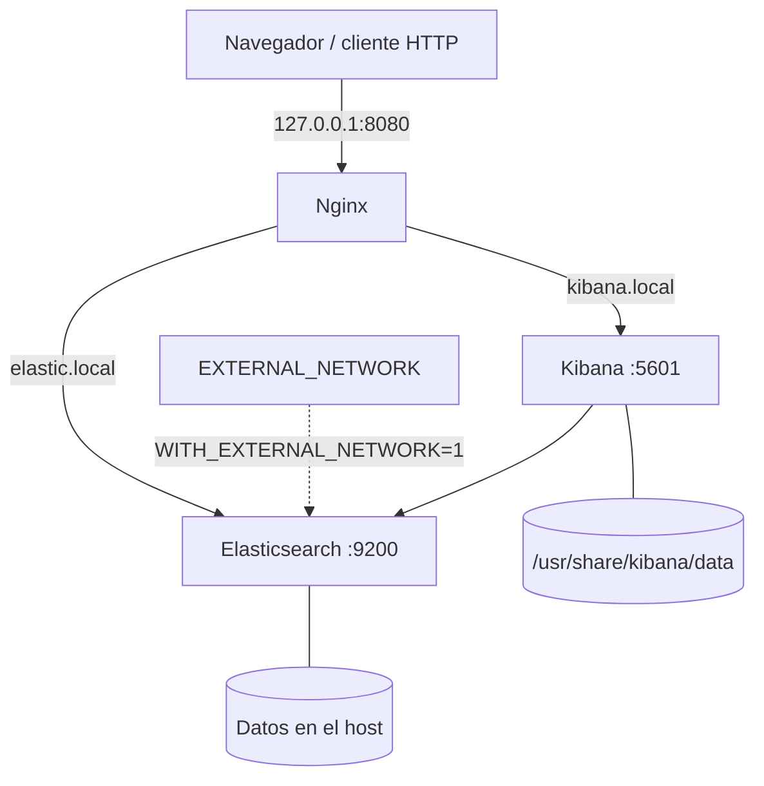

# Arquitectura y configuración

## Elegir idioma

| Русский | English | Español | 中文 | Français | Deutsch |
|---|---|---|---|---|---|
| [Русский](../../ru/reference/configuration.md) | [English](../../en/reference/configuration.md) | **Seleccionado** | [中文](../../zh/reference/configuration.md) | [Français](../../fr/reference/configuration.md) | [Deutsch](../../de/reference/configuration.md) |

Make lee `.docker.env` como configuración local de confianza. Conserve los valores existentes y compruebe la ruta de actualización antes de usar datos anteriores. Los comandos Compose directos requieren las mismas versiones exactas, nombres distintos y puertos internos fijos.

[`.docker.env.example`](../../../../.docker.env.example) · [`docker-compose.yml`](../../../../docker-compose.yml) · [`docker-compose.external.yml`](../../../../docker-compose.external.yml) · [`docker-configs/elasticsearch/elasticsearch.yml`](../../../../docker-configs/elasticsearch/elasticsearch.yml) · [`docker-configs/kibana/Dockerfile`](../../../../docker-configs/kibana/Dockerfile) · [`docker-configs/nginx/default.conf.template`](../../../../docker-configs/nginx/default.conf.template)

Use solo datos sintéticos. Los procesos locales, el navegador y los usuarios de Docker pueden acceder por HTTP sin autenticación. No publique el laboratorio en Internet.

## Servicios y límites de acceso



En el modo local, solo Nginx se publica en el host por loopback. Los puertos `9200` y `5601` son internos a la red Compose; Elasticsearch guarda los índices en un directorio del host. Kibana conecta con Elasticsearch dentro de la red, no por el dominio público.

`cluster.name: custom-cluster` · `discovery.type=single-node` · `ES_JAVA_OPTS=-Xms2048m -Xmx2048m` · `xpack.security.enabled: false`.

Compose inicia Kibana en segundo plano tras la comprobación HTTP de Elasticsearch. Revise /api/status para confirmar que Kibana está listo. Adapte las URL al dominio y puerto elegidos.

Kibana: `kibana-docker`, `ELASTICSEARCH_HOSTS=["http://elasticsearch:9200"]`, `SERVER_PUBLICBASEURL=http://${KIBANA_DOMAIN}:${NGINX_PORT}`. Nginx: `/etc/nginx/templates/default.conf.template` → `/etc/nginx/conf.d/default.conf`, `default_server` → HTTP 404. Nginx actualiza las direcciones mediante el DNS integrado de Docker. En `backend` usa los nombres de servicio `elasticsearch` y `kibana`.

## Variables de entorno

| Variable | Valor por defecto | Finalidad |
|---|---|---|
| `COMPOSE_PROJECT_NAME` | `docker-elasticsearch` | Nombre del proyecto Compose. |
| `ELASTIC_VERSION` | `9.5.7` | Etiqueta de imagen base oficial Elasticsearch. |
| `KIBANA_VERSION` | `9.5.7` | Etiqueta Kibana; debe coincidir con Elasticsearch. |
| `NGINX_VERSION` | `1.30.8-trixie` | `nginx:${NGINX_VERSION}` |
| `ELASTIC_CONTAINER` | `docker-elasticsearch-es` | Nombre explícito de contenedor; único en el host Docker. |
| `KIBANA_CONTAINER` | `docker-elasticsearch-kibana` | Nombre explícito de contenedor; único en el host Docker. |
| `NGINX_CONTAINER` | `docker-elasticsearch-nginx` | Nombre explícito de contenedor; único en el host Docker. |
| `KIBANA_DOMAIN` | `kibana.local` | Host virtual Nginx; use nombre local de confianza. |
| `ELASTIC_DOMAIN` | `elastic.local` | Host virtual Nginx; use nombre local de confianza. |
| `KIBANA_PORT` | `5601` | Puerto upstream interno, no publicado. |
| `ELASTIC_PORT` | `9200` | Puerto upstream interno, no publicado. |
| `NGINX_PORT` | `8080` | Puerto de Nginx en `127.0.0.1`. |
| `ELASTIC_DATA_DIR` | `./data/elasticsearch` | Bind mount para `/usr/share/elasticsearch/data`; guarda índices. |
| `KIBANA_DATA_DIR` | `./data/kibana` | → `/usr/share/kibana/data` |
| `EXTERNAL_NETWORK` | `external_network` | `WITH_EXTERNAL_NETWORK=1` |
| `WITH_EXTERNAL_NETWORK` | `0` | Opción Make. `0` selecciona el modo local y `1` añade la extensión. |

## Integración con otro proyecto

Localice la red de confianza existente de la aplicación con `docker network ls` y compruebe sus miembros con `docker network inspect`. Indique su nombre real en `EXTERNAL_NETWORK` en `.docker.env`. Compose combina el archivo base y la extensión, conserva `backend` y conecta solo Elasticsearch a la red adicional. Desde el contenedor de la aplicación use `http://docker-elasticsearch-es:9200` o el nombre real de `ELASTIC_CONTAINER`. Todos los miembros acceden sin autenticación. Use la misma opción en los comandos posteriores, incluida la parada.

```bash
docker network ls
make config WITH_EXTERNAL_NETWORK=1
make up WITH_EXTERNAL_NETWORK=1
```

```bash
make down WITH_EXTERNAL_NETWORK=1
```

Para cambiar de modo, ejecute `down` con los archivos o la opción anteriores, conserve ambas rutas de datos y ejecute `up` con la nueva configuración. La red externa queda con su propietario. Use solo la red y rutas acordadas. `restart` conserva la red de los contenedores existentes.

```bash
docker compose --env-file .docker.env -f docker-compose.yml -f docker-compose.external.yml config
docker compose --env-file .docker.env -f docker-compose.yml -f docker-compose.external.yml up -d
docker compose --env-file .docker.env -f docker-compose.yml -f docker-compose.external.yml down
```

## Persistencia y actualizaciones

Ambos montajes sobreviven a la recreación. Kibana guarda la mayoría de objetos en índices de sistema de Elasticsearch. Antes de parar el laboratorio anterior, revise `/usr/share/kibana/data` en su contenedor y guarde aparte los archivos locales necesarios.

[Instantáneas y actualización](../guides/operations.md)

## Documentación

- [Primeros pasos](../guides/getting-started.md)
- [Práctica de búsqueda y análisis de texto](../guides/search-lab.md)
- [Operación y comandos Make](../guides/operations.md)
- [Diagnóstico](../guides/troubleshooting.md)
- [Contribuir](../CONTRIBUTING.md)
