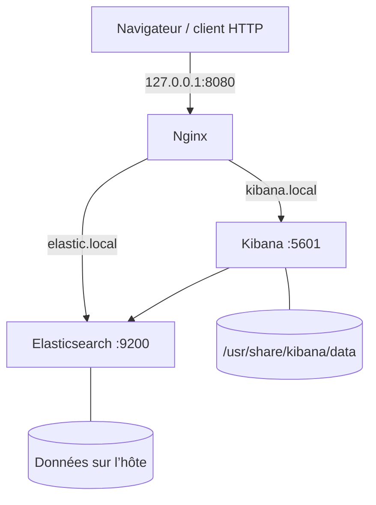

# Global Elasticsearch Stack

[](https://github.com/yaleksandr89/docker-elasticsearch)
[](https://www.elastic.co/elasticsearch)
[](https://www.elastic.co/kibana)
[](https://nginx.org/)
[](https://www.docker.com/)
[](https://github.com/yaleksandr89/docker-elasticsearch/actions/workflows/ci.yml)
[](../../../LICENSE.md)

## Choisir la langue

| Русский | English | Español | 中文 | Français | Deutsch |
|---|---|---|---|---|---|
| [Русский](../../../README.md) | [English](../en/README.md) | [Español](../es/README.md) | [中文](../zh/README.md) | **Sélectionné** | [Deutsch](../de/README.md) |

Un laboratoire local pour apprendre Elasticsearch : index, documents, recherche plein texte, filtres, agrégations et analyse de texte. Kibana offre Dev Tools et l’exploration des données ; Nginx achemine les requêtes HTTP vers le service concerné. Aucune base de produits n’est préchargée : créez l’index d’exercice en suivant le guide.

Utilisez uniquement des données synthétiques. Les processus locaux, le navigateur et les utilisateurs de Docker peuvent accéder au labo par HTTP sans authentification. Ne le publiez pas sur Internet.

## Fonctionnalités

- Elasticsearch à un nœud avec un heap JVM de 2 Gio ; `analysis-icu` et `analysis-phonetic` sont installés à la construction.
- Kibana pour les requêtes et l’exploration visuelle ; Nginx pour deux hôtes virtuels.
- Un mapping d’exercice, un petit jeu de données synthétiques et des exemples Query DSL.
- Un dictionnaire de synonymes géographiques est inclus dans l’image ; l’analyseur doit être configuré explicitement.

## Architecture du laboratoire



En mode local, seul Nginx est publié sur l’hôte via loopback. Les ports `9200` et `5601` sont internes au réseau Compose ; Elasticsearch stocke les index dans un répertoire de l’hôte. Kibana se connecte à Elasticsearch dans le réseau, pas via le domaine public.

## Prérequis

Git, GNU Make, Bash, curl, Docker Engine 28+ ou Docker Desktop avec Compose v2.14.2+. Linux, macOS ou Windows avec WSL2 est recommandé. La première construction nécessite l’accès aux registres officiels, aux dépôts du système et au serveur de plugins, de l’espace disque et au moins 4 Gio de mémoire disponible (6–8 Gio recommandés) ; Elasticsearch utilise un heap JVM de 2 Gio et Kibana et Docker demandent de la mémoire supplémentaire.

## Démarrage rapide

```bash
git clone https://github.com/yaleksandr89/docker-elasticsearch.git
cd docker-elasticsearch
make init
make config
```

Avant la construction, vérifiez le port libre, la mémoire Docker et la disponibilité des noms du projet et des trois conteneurs. Dans `make config`, vérifiez que seul le réseau `backend` existe et que seul `127.0.0.1:8080` est publié. Une seconde copie exige des noms, un port et deux répertoires distincts. Chaque utilisateur d’image doit pouvoir écrire dans son répertoire.

Avant la construction, lisez [Premiers pas](guides/getting-started.md).

```bash
docker compose ls -a
docker ps -a
ls -ld data/elasticsearch data/kibana
make build
make up
```

Compose démarre Kibana en arrière-plan après le contrôle HTTP d’Elasticsearch. Vérifiez sa disponibilité via /api/status. Adaptez les URL si vous changez le domaine ou le port. [Kibana](http://kibana.local:8080) · [Elasticsearch](http://elastic.local:8080)

```bash
curl --noproxy '*' --resolve elastic.local:8080:127.0.0.1 --fail --silent --show-error --max-time 10 http://elastic.local:8080/
curl --noproxy '*' --resolve kibana.local:8080:127.0.0.1 --fail --silent --show-error --max-time 10 http://kibana.local:8080/api/status
```

[Premiers pas](guides/getting-started.md) · [Exercices de recherche et d’analyse de texte](guides/search-lab.md)

## Vérifications

CI s’exécute sur push et pull request vers `master`, ainsi que manuellement via Actions. `quality` vérifie la syntaxe des scripts, les fixtures et Compose résolu ; `docker-smoke` construit un laboratoire isolé à versions fixes et vérifie HTTP via deux hôtes virtuels, plugins et recherche. Seuls les résultats CI établissent le succès.

## Documentation

- [Premiers pas](guides/getting-started.md)
- [Exercices de recherche et d’analyse de texte](guides/search-lab.md)
- [Exploitation et commandes Make](guides/operations.md)
- [Diagnostic](guides/troubleshooting.md)
- [Architecture et configuration](reference/configuration.md)
- [Contribuer](CONTRIBUTING.md)

## Retours

- Bugs reproductibles : [GitHub Issues](https://github.com/yaleksandr89/docker-elasticsearch/issues).
- Questions et idées : [GitHub Discussions](https://github.com/yaleksandr89/docker-elasticsearch/discussions).

---

<p align="center">
  Si le projet vous a été utile, ajoutez-lui une étoile sur GitHub afin que d’autres développeurs puissent le trouver plus facilement.
</p>
