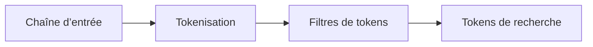

# Exercices de recherche et d’analyse de texte

## Choisir la langue

| Русский | English | Español | 中文 | Français | Deutsch |
|---|---|---|---|---|---|
| [Русский](../../ru/guides/search-lab.md) | [English](../../en/guides/search-lab.md) | [Español](../../es/guides/search-lab.md) | [中文](../../zh/guides/search-lab.md) | **Sélectionné** | [Deutsch](../../de/guides/search-lab.md) |

Objectif : créer un index d’exercice séparé, comprendre `text` et `keyword`, comparer Query DSL, analyseurs et agrégations. Exécutez uniquement dans le laboratoire local isolé du guide. Les données sont synthétiques, IDs 1–3. Les résultats sont attendus, pas des sorties enregistrées.

[Premiers pas](getting-started.md)

## Créer l’index et charger les données

[`products-index.json`](../../../examples/products-index.json) · [`products.ndjson`](../../../examples/products.ndjson)

Le mapping décrit les types de champs. `title` est du texte analysé avec analyseur de synonymes dédié à la recherche ; `title.folded` est un multi-field de folding Unicode, `brand.sound` un multi-field phonétique, `category` une valeur exacte pour filtres/agrégations, `price` un nombre et `in_stock` un booléen. Un shard primaire et zéro réplica pour pratiquer sur un seul nœud.

Depuis la racine du dépôt, vérifiez que `es-lab-products` n’existe pas (HTTP 404). S’il existe, n’écrasez pas les documents d’autrui : vérifiez d’abord son appartenance. `PUT` crée l’index avec mapping explicite ; `_bulk` reçoit du NDJSON terminé par un saut de ligne. `refresh=wait_for` attend la visibilité des enregistrements pour la recherche. Vérifiez `acknowledged: true`, `errors: false` dans bulk et un total de 3.

```bash
es() {
    curl --noproxy '*' --resolve elastic.local:8080:127.0.0.1 --fail --silent --show-error --max-time 30 "$@"
}
status=$(curl --noproxy '*' --resolve elastic.local:8080:127.0.0.1 --silent --show-error --max-time 10 --head --output /dev/null --write-out '%{http_code}' http://elastic.local:8080/es-lab-products)
test "$status" = 404
```

```bash
test "$status" = 404 && es -X PUT -H 'Content-Type: application/json' --data-binary @docs/examples/products-index.json http://elastic.local:8080/es-lab-products
```

Continuez uniquement après `acknowledged: true` ; arrêtez si la création échoue. Bulk utilise `create` : un chargement répété ne remplace pas les ID existants, mais des erreurs partielles sont possibles (vérifiez `errors` et `items`).

```bash
es -X POST -H 'Content-Type: application/x-ndjson' --data-binary @docs/examples/products.ndjson 'http://elastic.local:8080/es-lab-products/_bulk?refresh=wait_for'
es 'http://elastic.local:8080/es-lab-products/_count?pretty'
```

## Query DSL : recherche, filtres et agrégations

Exécutez les blocs suivants un par un dans Kibana Dev Tools → Console. Examinez `hits.hits` (documents), `_score` (pertinence) et `aggregations`. L’ordre des résultats de score égal n’est pas garanti.

`match` analyse la requête. Le synonyme de recherche `laptop, notebook` doit retourner 1 et 2.

```http
GET es-lab-products/_search
{"query":{"match":{"title":"laptop"}}}
```

`term` correspond à un `keyword` exact sans analyser la chaîne. Attendez 1 et 2. `term` sur `text` ne remplace pas `match`.

```http
GET es-lab-products/_search
{"query":{"term":{"category":"computers"}}}
```

`bool.must` contribue à la pertinence, `filter` restreint sans score. Pour les portables en stock de prix au plus 1000, attendez seulement 1.

```http
GET es-lab-products/_search
{
  "query": {
    "bool": {
      "must": {"match": {"title": "laptop"}},
      "filter": [
        {"term": {"in_stock": true}},
        {"range": {"price": {"lte": 1000}}}
      ]
    }
  }
}
```

`terms` regroupe par `category`. Avec `size: 0`, seules métadonnées et agrégations sont retournées : `computers: 2`, `audio: 1`.

```http
GET es-lab-products/_search
{"size":0,"aggs":{"categories":{"terms":{"field":"category"}}}}
```

## Fonctionnement de l’analyse de texte



Un analyseur transforme la chaîne en tokens. À l’indexation ils alimentent l’index inversé ; à la recherche ils servent à la correspondance. `_analyze` affiche le résultat sans ajouter de document. Les synonymes à la recherche élargissent la requête sans changer `_source`.

```http
POST es-lab-products/_analyze
{"analyzer":"lab_search","text":"laptop"}
```

ICU folding normalise Unicode, dont les diacritiques. Comparez `Café` et `cafe`, puis cherchez `title.folded` : document 3 attendu. Ce n’est pas une traduction universelle.

```http
POST es-lab-products/_analyze
{"analyzer":"lab_icu","text":["Café","cafe"]}

GET es-lab-products/_search
{"query":{"match":{"title.folded":"cafe"}}}
```

Double Metaphone encode la prononciation. `Smith` et `Smyth` doivent correspondre via `brand.sound` (1 et 2). Le champ normal `brand` reste disponible : la phonétique peut produire de faux positifs et dépend de la langue.

```http
POST es-lab-products/_analyze
{"analyzer":"lab_sound","text":["Smith","Smyth"]}

GET es-lab-products/_search
{"query":{"match":{"brand.sound":"Smith"}}}
```

Le dictionnaire `analysis/synonyms.txt` est copié dans la configuration Elasticsearch à la construction, sans être automatiquement associé à l’analyseur standard. Testez-le via `_analyze` ; `россия` est attendu parmi les tokens de `russia`. Il contient des variantes géographiques, n’est pas un dictionnaire général et peut nécessiter une révision. Utilisez `synonym_graph` à la recherche pour les synonymes multi-mots. Modifier le fichier nécessite de reconstruire l’image et d’appliquer les changements d’analyseur ; pas de réindexation automatique.

```http
POST /_analyze
{
  "tokenizer": "standard",
  "filter": ["lowercase", {"type":"synonym_graph","synonyms_path":"analysis/synonyms.txt"}],
  "text": "russia"
}
```

## Kibana Discover

Dans Kibana Discover, créez une data view pour `es-lab-products`, sans champ temporel (pas de timestamp). Ouvrez les documents, ajoutez `category`, `price`, `in_stock` et comparez les filtres avec Query DSL. Les menus peuvent varier selon la version.

## Terminer l’exercice

Conservez l’index pour d’autres requêtes. Si vous êtes certain de l’avoir créé dans ce laboratoire jetable et n’en avez plus besoin, la commande suivante efface documents et mapping sans récupération automatique. N’utilisez pas de joker ni un autre cluster.

```http
DELETE es-lab-products
```

## Documentation officielle

- [Match query](https://www.elastic.co/docs/reference/query-languages/query-dsl/query-dsl-match-query)
- [ICU analysis](https://www.elastic.co/docs/reference/elasticsearch/plugins/analysis-icu)
- [Phonetic filter](https://www.elastic.co/docs/reference/elasticsearch/plugins/analysis-phonetic-token-filter)
- [Synonym graph](https://www.elastic.co/docs/reference/text-analysis/analysis-synonym-graph-tokenfilter)

## Documentation

- [Premiers pas](getting-started.md)
- [Exploitation et commandes Make](operations.md)
- [Diagnostic](troubleshooting.md)
- [Architecture et configuration](../reference/configuration.md)
- [Contribuer](../CONTRIBUTING.md)
