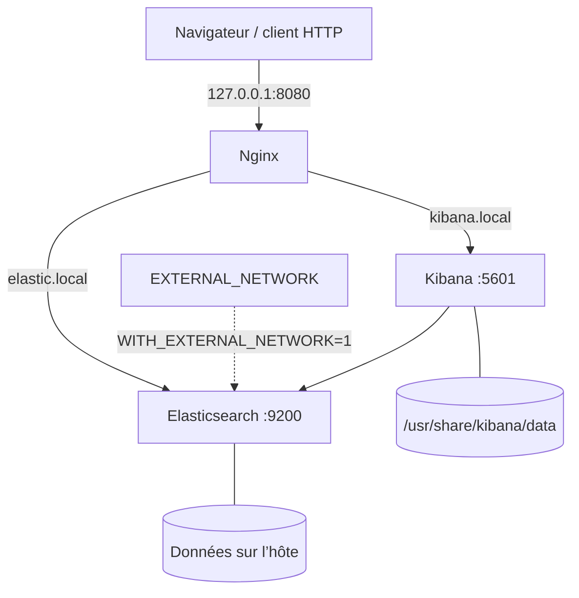

# Architecture et configuration

## Choisir la langue

| Русский | English | Español | 中文 | Français | Deutsch |
|---|---|---|---|---|---|
| [Русский](../../ru/reference/configuration.md) | [English](../../en/reference/configuration.md) | [Español](../../es/reference/configuration.md) | [中文](../../zh/reference/configuration.md) | **Sélectionné** | [Deutsch](../../de/reference/configuration.md) |

Make lit `.docker.env` comme configuration locale de confiance. Conservez les réglages existants et vérifiez le parcours de mise à niveau avant de démarrer sur des données antérieures. Les appels directs à Compose exigent les mêmes versions exactes, des noms distincts et les mêmes ports internes fixes.

[`.docker.env.example`](../../../../.docker.env.example) · [`docker-compose.yml`](../../../../docker-compose.yml) · [`docker-compose.external.yml`](../../../../docker-compose.external.yml) · [`docker-configs/elasticsearch/elasticsearch.yml`](../../../../docker-configs/elasticsearch/elasticsearch.yml) · [`docker-configs/kibana/Dockerfile`](../../../../docker-configs/kibana/Dockerfile) · [`docker-configs/nginx/default.conf.template`](../../../../docker-configs/nginx/default.conf.template)

Utilisez uniquement des données synthétiques. Les processus locaux, le navigateur et les utilisateurs de Docker peuvent accéder au labo par HTTP sans authentification. Ne le publiez pas sur Internet.

## Services et limites d’accès



En mode local, seul Nginx est publié sur l’hôte via loopback. Les ports `9200` et `5601` sont internes au réseau Compose ; Elasticsearch stocke les index dans un répertoire de l’hôte. Kibana se connecte à Elasticsearch dans le réseau, pas via le domaine public.

`cluster.name: custom-cluster` · `discovery.type=single-node` · `ES_JAVA_OPTS=-Xms2048m -Xmx2048m` · `xpack.security.enabled: false`.

Compose démarre Kibana en arrière-plan après le contrôle HTTP d’Elasticsearch. Vérifiez sa disponibilité via /api/status. Adaptez les URL si vous changez le domaine ou le port.

Kibana: `kibana-docker`, `ELASTICSEARCH_HOSTS=["http://elasticsearch:9200"]`, `SERVER_PUBLICBASEURL=http://${KIBANA_DOMAIN}:${NGINX_PORT}`. Nginx: `/etc/nginx/templates/default.conf.template` → `/etc/nginx/conf.d/default.conf`, `default_server` → HTTP 404. Nginx actualise les adresses amont via le DNS intégré de Docker. Dans `backend`, il utilise les noms de service `elasticsearch` et `kibana`.

## Variables d’environnement

| Variable | Défaut | Rôle |
|---|---|---|
| `COMPOSE_PROJECT_NAME` | `docker-elasticsearch` | Nom du projet Compose. |
| `ELASTIC_VERSION` | `9.5.7` | Tag de l’image de base officielle Elasticsearch. |
| `KIBANA_VERSION` | `9.5.7` | Tag Kibana ; doit correspondre à Elasticsearch. |
| `NGINX_VERSION` | `1.30.8-trixie` | `nginx:${NGINX_VERSION}` |
| `ELASTIC_CONTAINER` | `docker-elasticsearch-es` | Nom explicite de conteneur ; unique sur l’hôte Docker. |
| `KIBANA_CONTAINER` | `docker-elasticsearch-kibana` | Nom explicite de conteneur ; unique sur l’hôte Docker. |
| `NGINX_CONTAINER` | `docker-elasticsearch-nginx` | Nom explicite de conteneur ; unique sur l’hôte Docker. |
| `KIBANA_DOMAIN` | `kibana.local` | Hôte virtuel Nginx ; utilisez un nom local de confiance. |
| `ELASTIC_DOMAIN` | `elastic.local` | Hôte virtuel Nginx ; utilisez un nom local de confiance. |
| `KIBANA_PORT` | `5601` | Port upstream interne, non publié. |
| `ELASTIC_PORT` | `9200` | Port upstream interne, non publié. |
| `NGINX_PORT` | `8080` | Port hôte de Nginx sur `127.0.0.1`. |
| `ELASTIC_DATA_DIR` | `./data/elasticsearch` | Bind mount de `/usr/share/elasticsearch/data` ; stocke les index. |
| `KIBANA_DATA_DIR` | `./data/kibana` | → `/usr/share/kibana/data` |
| `EXTERNAL_NETWORK` | `external_network` | `WITH_EXTERNAL_NETWORK=1` |
| `WITH_EXTERNAL_NETWORK` | `0` | Option Make. `0` sélectionne le mode local et `1` ajoute l’extension. |

## Intégration à un autre projet

Repérez le réseau existant et de confiance de l’application avec `docker network ls` et vérifiez ses membres avec `docker network inspect`. Renseignez son nom réel dans `EXTERNAL_NETWORK` dans `.docker.env`. Compose fusionne les fichiers, conserve `backend` et ajoute seulement Elasticsearch au réseau supplémentaire. Depuis le conteneur applicatif, utilisez `http://docker-elasticsearch-es:9200` ou le nom réel de `ELASTIC_CONTAINER`. Tous les membres accèdent sans authentification. Gardez ce paramètre pour les commandes suivantes, y compris l’arrêt.

```bash
docker network ls
make config WITH_EXTERNAL_NETWORK=1
make up WITH_EXTERNAL_NETWORK=1
```

```bash
make down WITH_EXTERNAL_NETWORK=1
```

Pour changer de mode, lancez `down` avec les anciens fichiers ou l’ancienne option, gardez les deux chemins de données, puis lancez `up` avec le nouveau réglage. Le réseau externe reste à son propriétaire. Utilisez uniquement le réseau et les chemins convenus. `restart` garde les réglages réseau des conteneurs existants.

```bash
docker compose --env-file .docker.env -f docker-compose.yml -f docker-compose.external.yml config
docker compose --env-file .docker.env -f docker-compose.yml -f docker-compose.external.yml up -d
docker compose --env-file .docker.env -f docker-compose.yml -f docker-compose.external.yml down
```

## Persistance et mises à jour

Les deux montages persistent après recréation. Kibana stocke la plupart des objets dans les index système d’Elasticsearch. Avant d’arrêter l’ancien labo, inspectez `/usr/share/kibana/data` dans son conteneur et gardez à part les fichiers locaux nécessaires.

[Snapshots et mise à niveau](../guides/operations.md)

## Documentation

- [Premiers pas](../guides/getting-started.md)
- [Exercices de recherche et d’analyse de texte](../guides/search-lab.md)
- [Exploitation et commandes Make](../guides/operations.md)
- [Diagnostic](../guides/troubleshooting.md)
- [Contribuer](../CONTRIBUTING.md)
