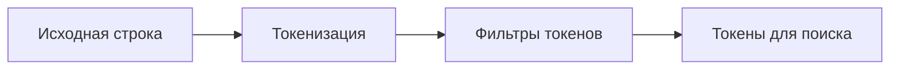

# Практика поиска и анализа текста

## Выберите язык

| Русский | English | Español | 中文 | Français | Deutsch |
|---|---|---|---|---|---|
| **Выбран** | [English](../../en/guides/search-lab.md) | [Español](../../es/guides/search-lab.md) | [中文](../../zh/guides/search-lab.md) | [Français](../../fr/guides/search-lab.md) | [Deutsch](../../de/guides/search-lab.md) |

Цель: создать отдельный учебный индекс, понять разницу между `text` и `keyword`, сравнить Query DSL, анализаторы и агрегации. Запускайте только в изолированном локальном стенде из руководства. Данные синтетические, идентификаторы 1–3. Ниже указаны ожидаемые результаты, а не запись уже выполненного запроса.

[Начало работы](getting-started.md)

## Создание индекса и загрузка данных

[`products-index.json`](../../../examples/products-index.json) · [`products.ndjson`](../../../examples/products.ndjson)

Mapping описывает типы полей. `title` — анализируемый текст с отдельным поисковым анализатором синонимов, `title.folded` — дополнительное представление для Unicode folding, `brand.sound` — фонетическое представление, `category` — точное значение для фильтра/агрегации, `price` — число, `in_stock` — boolean. У индекса один primary shard и ноль replicas для одноузловой практики.

Из корня репозитория проверьте, что индекс `es-lab-products` не существует (HTTP 404). Если он существует, не перезаписывайте чужие документы: сначала проверьте принадлежность индекса. `PUT` создаёт индекс с явным mapping; `_bulk` принимает NDJSON с завершающим переводом строки. `refresh=wait_for` ждёт видимости записей для поиска. Проверьте `acknowledged: true`, `errors: false` в bulk и `_count: 3`.

```bash
es() {
    curl --noproxy '*' --resolve elastic.local:8080:127.0.0.1 --fail --silent --show-error --max-time 30 "$@"
}
status=$(curl --noproxy '*' --resolve elastic.local:8080:127.0.0.1 --silent --show-error --max-time 10 --head --output /dev/null --write-out '%{http_code}' http://elastic.local:8080/es-lab-products)
test "$status" = 404
```

```bash
test "$status" = 404 && es -X PUT -H 'Content-Type: application/json' --data-binary @docs/examples/products-index.json http://elastic.local:8080/es-lab-products
```

Продолжайте только после `acknowledged: true`; при ошибке создания индекса остановитесь. Bulk использует действие `create`: повторная загрузка не перезапишет существующие ID, но возможны частичные ошибки (проверяйте `errors` и элементы `items`).

```bash
es -X POST -H 'Content-Type: application/x-ndjson' --data-binary @docs/examples/products.ndjson 'http://elastic.local:8080/es-lab-products/_bulk?refresh=wait_for'
es 'http://elastic.local:8080/es-lab-products/_count?pretty'
```

## Query DSL: поиск, фильтры и агрегации

Следующие блоки выполняйте по одному в Kibana Dev Tools → Console. Для анализа JSON-ответа смотрите `hits.hits` (документы), `_score` (оценка релевантности) и `aggregations`. Порядок равноценных результатов не гарантируется.

`match` анализирует запрос. Благодаря поисковому синониму `laptop, notebook` ожидаются документы 1 и 2.

```http
GET es-lab-products/_search
{"query":{"match":{"title":"laptop"}}}
```

`term` работает с точным `keyword`, без анализа строки. Запрос ожидает документы 1 и 2. `term` на `text` не заменяет полнотекстовый `match`.

```http
GET es-lab-products/_search
{"query":{"term":{"category":"computers"}}}
```

`bool.must` учитывает релевантность, `filter` ограничивает выдачу без оценки релевантности. Для ноутбуков в наличии с ценой не выше 1000 ожидается только документ 1.

```http
GET es-lab-products/_search
{
  "query": {
    "bool": {
      "must": {"match": {"title": "laptop"}},
      "filter": [
        {"term": {"in_stock": true}},
        {"range": {"price": {"lte": 1000}}}
      ]
    }
  }
}
```

`terms` группирует по `category`. При `size: 0` возвращаются только метаданные и агрегации: ожидаются `computers: 2`, `audio: 1`.

```http
GET es-lab-products/_search
{"size":0,"aggs":{"categories":{"terms":{"field":"category"}}}}
```

## Как работает анализ текста



Анализатор преобразует строку в токены. При индексации токены сохраняются в инвертированном индексе, при поиске — используются для сопоставления. `_analyze` позволяет увидеть результат без добавления документа. Синонимы на этапе поиска расширяют запрос, не меняя исходный `_source`.

```http
POST es-lab-products/_analyze
{"analyzer":"lab_search","text":"laptop"}
```

ICU folding нормализует Unicode, в том числе диакритические знаки. Сравните токены `Café` и `cafe`, затем выполните поиск по `title.folded`: ожидается документ 3. Это не универсальный перевод между языками.

```http
POST es-lab-products/_analyze
{"analyzer":"lab_icu","text":["Café","cafe"]}

GET es-lab-products/_search
{"query":{"match":{"title.folded":"cafe"}}}
```

Double Metaphone кодирует звучание. `Smith` и `Smyth` должны совпасть по `brand.sound` (1 и 2). Обычное поле `brand` сохраняется для отдельного поиска: фонетика может давать ложные совпадения и зависит от языка.

```http
POST es-lab-products/_analyze
{"analyzer":"lab_sound","text":["Smith","Smyth"]}

GET es-lab-products/_search
{"query":{"match":{"brand.sound":"Smith"}}}
```

Словарь проекта `analysis/synonyms.txt` копируется в конфигурацию Elasticsearch при сборке, но не подключён к стандартному анализатору автоматически. Проверьте явно через `_analyze`; среди токенов для `russia` ожидается `россия`. Словарь содержит варианты географических имён, не является общим языковым словарём и может требовать редакторской проверки. Для многочастных синонимов используйте `synonym_graph` на этапе поиска. Изменение файла требует новой сборки образа и подходящего применения изменений анализатора; не обещает автоматического переиндексирования.

```http
POST /_analyze
{
  "tokenizer": "standard",
  "filter": ["lowercase", {"type":"synonym_graph","synonyms_path":"analysis/synonyms.txt"}],
  "text": "russia"
}
```

## Kibana Discover

В Kibana Discover создайте data view для `es-lab-products`, без поля времени (в mapping нет timestamp). Откройте документы, добавьте `category`, `price`, `in_stock` и сравните фильтры с Query DSL. Названия меню могут различаться в зависимости от версии Kibana.

## Завершение упражнения

Индекс можно сохранить для следующих запросов. Если он точно создан вами в одноразовом стенде и больше не нужен, следующая команда удаляет все его документы и mapping без автоматического восстановления. Не используйте wildcard и не запускайте её на чужом кластере.

```http
DELETE es-lab-products
```

## Официальная документация

- [Match query](https://www.elastic.co/docs/reference/query-languages/query-dsl/query-dsl-match-query)
- [ICU analysis](https://www.elastic.co/docs/reference/elasticsearch/plugins/analysis-icu)
- [Phonetic filter](https://www.elastic.co/docs/reference/elasticsearch/plugins/analysis-phonetic-token-filter)
- [Synonym graph](https://www.elastic.co/docs/reference/text-analysis/analysis-synonym-graph-tokenfilter)

## Документация

- [Начало работы](getting-started.md)
- [Эксплуатация и Make-команды](operations.md)
- [Диагностика](troubleshooting.md)
- [Архитектура и конфигурация](../reference/configuration.md)
- [Участие в разработке](../../../../.github/CONTRIBUTING.md)
