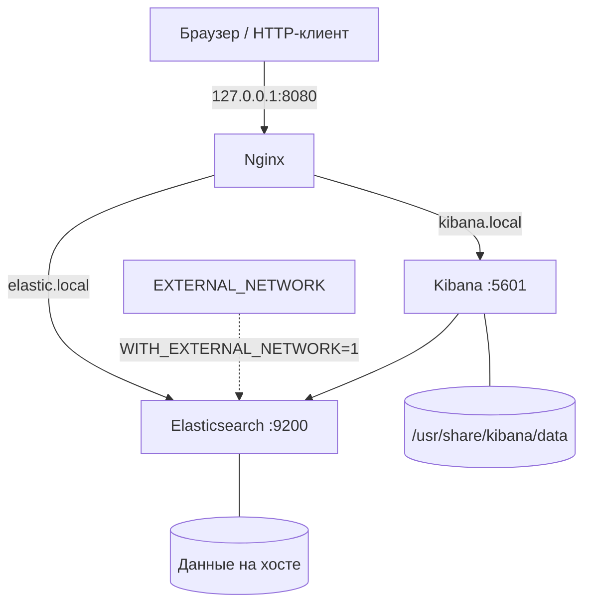

# Архитектура и конфигурация

## Выберите язык

| Русский | English | Español | 中文 | Français | Deutsch |
|---|---|---|---|---|---|
| **Выбран** | [English](../../en/reference/configuration.md) | [Español](../../es/reference/configuration.md) | [中文](../../zh/reference/configuration.md) | [Français](../../fr/reference/configuration.md) | [Deutsch](../../de/reference/configuration.md) |

Make читает `.docker.env` как доверенную локальную конфигурацию. Сохраните существующие значения и проверьте путь обновления перед запуском с прежними данными. Для прямого вызова Compose действуют те же требования к версиям, именам и внутренним портам.

[`.docker.env.example`](../../../../.docker.env.example) · [`docker-compose.yml`](../../../../docker-compose.yml) · [`docker-compose.external.yml`](../../../../docker-compose.external.yml) · [`docker-configs/elasticsearch/elasticsearch.yml`](../../../../docker-configs/elasticsearch/elasticsearch.yml) · [`docker-configs/kibana/Dockerfile`](../../../../docker-configs/kibana/Dockerfile) · [`docker-configs/nginx/default.conf.template`](../../../../docker-configs/nginx/default.conf.template)

Только для обучения на синтетических данных. Локальные процессы, браузер и пользователи Docker могут обращаться к стенду по HTTP без пароля. Не публикуйте его в интернете.

## Сервисы и границы доступа



В локальном сценарии только Nginx доступен с хоста через loopback. Порты `9200` и `5601` используются внутри сети Compose; Elasticsearch сохраняет индексы в каталоге хоста. Kibana обращается к Elasticsearch внутри сети, а не через публичный домен.

`cluster.name: custom-cluster` · `discovery.type=single-node` · `ES_JAVA_OPTS=-Xms2048m -Xmx2048m` · `xpack.security.enabled: false`.

После успешной HTTP-проверки Elasticsearch Compose запускает Kibana в фоне. Проверьте готовность Kibana через /api/status. При смене домена или порта измените адреса в примерах.

Kibana: `kibana-docker`, `ELASTICSEARCH_HOSTS=["http://elasticsearch:9200"]`, `SERVER_PUBLICBASEURL=http://${KIBANA_DOMAIN}:${NGINX_PORT}`. Nginx: `/etc/nginx/templates/default.conf.template` → `/etc/nginx/conf.d/default.conf`, `default_server` → HTTP 404. При смене адреса upstream Nginx обновляет его через встроенный DNS Docker. Внутри `backend` используются имена сервисов `elasticsearch` и `kibana`.

## Переменные окружения

| Переменная | По умолчанию | Назначение |
|---|---|---|
| `COMPOSE_PROJECT_NAME` | `docker-elasticsearch` | Имя Compose-проекта. |
| `ELASTIC_VERSION` | `9.5.7` | Тег официального базового образа Elasticsearch. |
| `KIBANA_VERSION` | `9.5.7` | Тег Kibana; должен совпадать с Elasticsearch. |
| `NGINX_VERSION` | `1.30.8-trixie` | `nginx:${NGINX_VERSION}` |
| `ELASTIC_CONTAINER` | `docker-elasticsearch-es` | Явное имя контейнера; должно быть уникально на Docker-хосте. |
| `KIBANA_CONTAINER` | `docker-elasticsearch-kibana` | Явное имя контейнера; должно быть уникально на Docker-хосте. |
| `NGINX_CONTAINER` | `docker-elasticsearch-nginx` | Явное имя контейнера; должно быть уникально на Docker-хосте. |
| `KIBANA_DOMAIN` | `kibana.local` | Имя виртуального хоста Nginx; используйте доверенное локальное имя. |
| `ELASTIC_DOMAIN` | `elastic.local` | Имя виртуального хоста Nginx; используйте доверенное локальное имя. |
| `KIBANA_PORT` | `5601` | Внутренний upstream-порт, не опубликован на хосте. |
| `ELASTIC_PORT` | `9200` | Внутренний upstream-порт, не опубликован на хосте. |
| `NGINX_PORT` | `8080` | Порт Nginx на `127.0.0.1`. |
| `ELASTIC_DATA_DIR` | `./data/elasticsearch` | Bind mount для `/usr/share/elasticsearch/data`; хранит индексы. |
| `KIBANA_DATA_DIR` | `./data/kibana` | → `/usr/share/kibana/data` |
| `EXTERNAL_NETWORK` | `external_network` | `WITH_EXTERNAL_NETWORK=1` |
| `WITH_EXTERNAL_NETWORK` | `0` | Параметр Make. `0` — локальный режим, `1` — расширение. |

## Интеграция с другим проектом

Узнайте фактическое имя существующей доверенной сети приложения через `docker network ls`, сверив участников через `docker network inspect`. Укажите её в `EXTERNAL_NETWORK` файла `.docker.env`. Compose объединит базовый файл и расширение, оставит `backend` и подключит к дополнительной сети только Elasticsearch. Из контейнера приложения используйте `http://docker-elasticsearch-es:9200` или фактическое имя `ELASTIC_CONTAINER`. Все участники сети получают доступ без аутентификации. Используйте тот же флаг для последующих команд, в том числе остановки.

```bash
docker network ls
make config WITH_EXTERNAL_NETWORK=1
make up WITH_EXTERNAL_NETWORK=1
```

```bash
make down WITH_EXTERNAL_NETWORK=1
```

Перед сменой режима выполните `down` с прежним набором файлов или флагом, сохраните оба пути данных и выполните `up` с новым набором. Внешняя сеть остаётся у её владельца. Не используйте чужие сети и каталоги. `restart` сохраняет сетевые настройки существующих контейнеров.

```bash
docker compose --env-file .docker.env -f docker-compose.yml -f docker-compose.external.yml config
docker compose --env-file .docker.env -f docker-compose.yml -f docker-compose.external.yml up -d
docker compose --env-file .docker.env -f docker-compose.yml -f docker-compose.external.yml down
```

## Хранение данных и обновления

Оба bind mount переживают пересоздание. Большая часть сохранённых объектов Kibana находится в системных индексах Elasticsearch. Перед остановкой прежнего стенда проверьте `/usr/share/kibana/data` в его контейнере и отдельно сохраните нужные локальные файлы.

[Снимки и обновление](../guides/operations.md)

## Документация

- [Начало работы](../guides/getting-started.md)
- [Практика поиска и анализа текста](../guides/search-lab.md)
- [Эксплуатация и Make-команды](../guides/operations.md)
- [Диагностика](../guides/troubleshooting.md)
- [Участие в разработке](../../../../.github/CONTRIBUTING.md)
