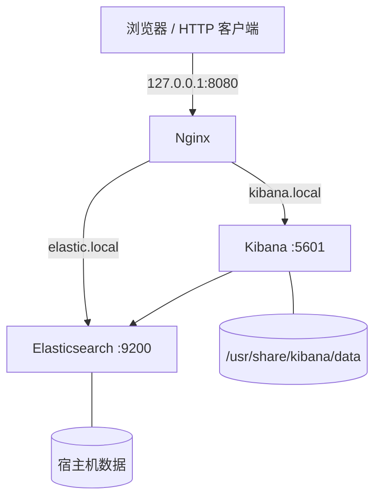

# Global Elasticsearch Stack

[](https://github.com/yaleksandr89/docker-elasticsearch)
[](https://www.elastic.co/elasticsearch)
[](https://www.elastic.co/kibana)
[](https://nginx.org/)
[](https://www.docker.com/)
[](https://github.com/yaleksandr89/docker-elasticsearch/actions/workflows/ci.yml)
[](../../../LICENSE.md)

## 选择语言

| Русский | English | Español | 中文 | Français | Deutsch |
|---|---|---|---|---|---|
| [Русский](../../../README.md) | [English](../en/README.md) | [Español](../es/README.md) | **已选** | [Français](../fr/README.md) | [Deutsch](../de/README.md) |

本地 Elasticsearch 学习环境：索引、文档、全文搜索、过滤、聚合和文本分析。Kibana 提供 Dev Tools 和数据探索功能；Nginx 将 HTTP 请求转发给相应服务。环境不预装商品数据库，请按指南创建练习索引。

仅限合成数据。本机进程、浏览器和有 Docker 权限的用户均可通过 HTTP 免认证访问。请勿将环境暴露到公网。

## 功能

- 单节点 Elasticsearch，JVM 堆为 2 GiB；构建时安装 `analysis-icu` 和 `analysis-phonetic`。
- Kibana 用于查询与可视化探索；Nginx 提供两个虚拟主机。
- 练习 mapping、小型合成数据集和 Query DSL 示例。
- 镜像内置地理名称同义词词典，但需显式配置分析器。

## 实验环境架构



本地模式仅通过 loopback 将 Nginx 发布到宿主机。`9200` 与 `5601` 为 Compose 网络内部端口；Elasticsearch 将索引保存于宿主机目录。Kibana 在网络内部连接 Elasticsearch，而非通过公开域名。

## 要求

Git、GNU Make、Bash、curl、Docker Engine 28+ 或 Docker Desktop，Compose v2.14.2+。推荐 Linux、macOS 或 Windows + WSL2。首次构建需要访问官方镜像仓库、系统软件仓库和插件服务器，并有可用磁盘及至少 4 GiB 可用内存（推荐 6–8 GiB）；Elasticsearch JVM 堆为 2 GiB，Kibana 和 Docker 还需额外内存。

## 快速开始

```bash
git clone https://github.com/yaleksandr89/docker-elasticsearch.git
cd docker-elasticsearch
make init
make config
```

构建前检查端口是否空闲、Docker 内存及项目名和三个容器名是否可用。`make config` 应仅显示 `backend` 网络，且只发布 `127.0.0.1:8080`。第二份环境需使用独立的名称、端口和两个数据目录。镜像用户须能写入各自目录。

构建前阅读 [入门](guides/getting-started.md).

```bash
docker compose ls -a
docker ps -a
ls -ld data/elasticsearch data/kibana
make build
make up
```

Elasticsearch 通过 HTTP 健康检查后，Compose 在后台启动 Kibana。请通过 /api/status 确认 Kibana 就绪。自定义域名或端口时请同步修改示例 URL。 [Kibana](http://kibana.local:8080) · [Elasticsearch](http://elastic.local:8080)

```bash
curl --noproxy '*' --resolve elastic.local:8080:127.0.0.1 --fail --silent --show-error --max-time 10 http://elastic.local:8080/
curl --noproxy '*' --resolve kibana.local:8080:127.0.0.1 --fail --silent --show-error --max-time 10 http://kibana.local:8080/api/status
```

[入门](guides/getting-started.md) · [搜索与文本分析练习](guides/search-lab.md)

## 检查

CI 在 `master` 的 push、pull request 及 Actions 手动触发时运行。`quality` 检查启动脚本语法、练习 fixtures 和解析后的 Compose；`docker-smoke` 使用固定版本构建隔离环境，检查两个虚拟主机的 HTTP、插件及搜索。只有 CI 实际结果才能证明成功。

## 文档

- [入门](guides/getting-started.md)
- [搜索与文本分析练习](guides/search-lab.md)
- [运维与 Make 命令](guides/operations.md)
- [故障排查](guides/troubleshooting.md)
- [架构与配置](reference/configuration.md)
- [参与贡献](CONTRIBUTING.md)

## 反馈

- 可复现的错误：[GitHub Issues](https://github.com/yaleksandr89/docker-elasticsearch/issues)。
- 问题和想法：[GitHub Discussions](https://github.com/yaleksandr89/docker-elasticsearch/discussions)。
- 漏洞：[安全政策](SECURITY.md)。

---

<p align="center">
  如果这个项目对你有帮助，请在 GitHub 上点一颗 Star，让其他开发者更容易找到它。 🤘
</p>
