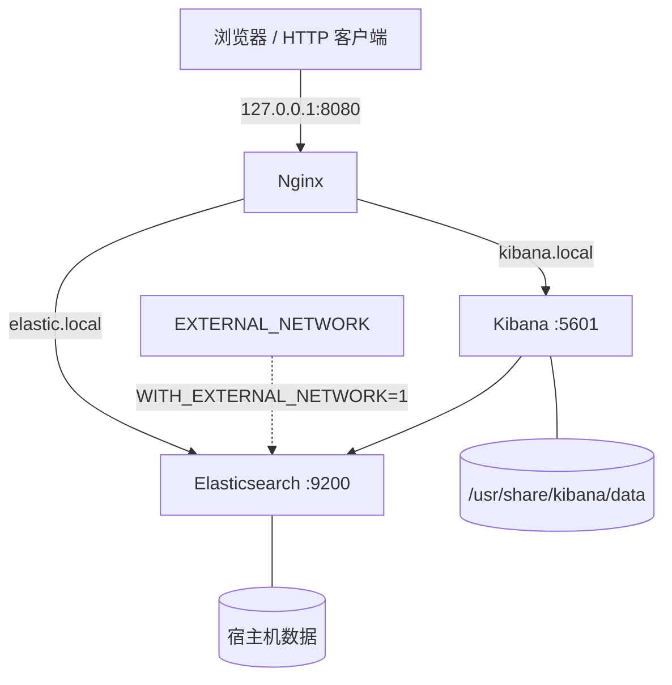

# 架构与配置

## 选择语言

| Русский | English | Español | 中文 | Français | Deutsch |
|---|---|---|---|---|---|
| [Русский](../../ru/reference/configuration.md) | [English](../../en/reference/configuration.md) | [Español](../../es/reference/configuration.md) | **已选** | [Français](../../fr/reference/configuration.md) | [Deutsch](../../de/reference/configuration.md) |

Make 将 `.docker.env` 作为可信的本地配置读取。保留原有配置，使用旧数据前请核对升级路径。直接调用 Compose 时也需遵守相同的精确版本、名称区分和固定内部端口要求。

[`.docker.env.example`](../../../../.docker.env.example) · [`docker-compose.yml`](../../../../docker-compose.yml) · [`docker-compose.external.yml`](../../../../docker-compose.external.yml) · [`docker-configs/elasticsearch/elasticsearch.yml`](../../../../docker-configs/elasticsearch/elasticsearch.yml) · [`docker-configs/kibana/Dockerfile`](../../../../docker-configs/kibana/Dockerfile) · [`docker-configs/nginx/default.conf.template`](../../../../docker-configs/nginx/default.conf.template)

仅限合成数据。本机进程、浏览器和有 Docker 权限的用户均可通过 HTTP 免认证访问。请勿将环境暴露到公网。

## 服务与访问边界



本地模式仅通过 loopback 将 Nginx 发布到宿主机。`9200` 与 `5601` 为 Compose 网络内部端口；Elasticsearch 将索引保存于宿主机目录。Kibana 在网络内部连接 Elasticsearch，而非通过公开域名。

`cluster.name: custom-cluster` · `discovery.type=single-node` · `ES_JAVA_OPTS=-Xms2048m -Xmx2048m` · `xpack.security.enabled: false`.

Elasticsearch 通过 HTTP 健康检查后，Compose 在后台启动 Kibana。请通过 /api/status 确认 Kibana 就绪。自定义域名或端口时请同步修改示例 URL。

Kibana: `kibana-docker`, `ELASTICSEARCH_HOSTS=["http://elasticsearch:9200"]`, `SERVER_PUBLICBASEURL=http://${KIBANA_DOMAIN}:${NGINX_PORT}`. Nginx: `/etc/nginx/templates/default.conf.template` → `/etc/nginx/conf.d/default.conf`, `default_server` → HTTP 404. Nginx 通过 Docker 内置 DNS 刷新上游地址。在 `backend` 中使用服务名 `elasticsearch` 和 `kibana`。

## 环境变量

| 变量 | 默认值 | 用途 |
|---|---|---|
| `COMPOSE_PROJECT_NAME` | `docker-elasticsearch` | Compose 项目名。 |
| `ELASTIC_VERSION` | `9.5.7` | 官方 Elasticsearch 基础镜像标签。 |
| `KIBANA_VERSION` | `9.5.7` | Kibana 标签，须与 Elasticsearch 一致。 |
| `NGINX_VERSION` | `1.30.8-trixie` | `nginx:${NGINX_VERSION}` |
| `ELASTIC_CONTAINER` | `docker-elasticsearch-es` | 显式容器名；在 Docker 主机唯一。 |
| `KIBANA_CONTAINER` | `docker-elasticsearch-kibana` | 显式容器名；在 Docker 主机唯一。 |
| `NGINX_CONTAINER` | `docker-elasticsearch-nginx` | 显式容器名；在 Docker 主机唯一。 |
| `KIBANA_DOMAIN` | `kibana.local` | Nginx 虚拟主机名；使用可信本地名称。 |
| `ELASTIC_DOMAIN` | `elastic.local` | Nginx 虚拟主机名；使用可信本地名称。 |
| `KIBANA_PORT` | `5601` | 内部 upstream 端口，不发布至宿主机。 |
| `ELASTIC_PORT` | `9200` | 内部 upstream 端口，不发布至宿主机。 |
| `NGINX_PORT` | `8080` | Nginx 在 `127.0.0.1` 上的主机端口。 |
| `ELASTIC_DATA_DIR` | `./data/elasticsearch` | `/usr/share/elasticsearch/data` 的 bind mount，保存索引。 |
| `KIBANA_DATA_DIR` | `./data/kibana` | → `/usr/share/kibana/data` |
| `EXTERNAL_NETWORK` | `external_network` | `WITH_EXTERNAL_NETWORK=1` |
| `WITH_EXTERNAL_NETWORK` | `0` | Make 选项。`0` 使用本地模式，`1` 加载扩展。 |

## 与其他项目集成

用 `docker network ls` 找到应用现有的可信网络，用 `docker network inspect` 核对成员，把实际名称写入 `.docker.env` 的 `EXTERNAL_NETWORK`。Compose 合并基础文件和扩展文件，保留 `backend`，并仅将 Elasticsearch 接入额外网络。从应用容器访问 `http://docker-elasticsearch-es:9200` 或实际的 `ELASTIC_CONTAINER` 名称。所有网络成员均可免认证访问。后续命令（包括停止）使用同一选项。

```bash
docker network ls
make config WITH_EXTERNAL_NETWORK=1
make up WITH_EXTERNAL_NETWORK=1
```

```bash
make down WITH_EXTERNAL_NETWORK=1
```

切换模式前先用原文件组合或选项执行 `down`，保留两个数据路径，再用新配置执行 `up`。外部网络仍归其所有者。只使用约定的网络和数据路径。`restart` 保留现有容器的网络设置。

```bash
docker compose --env-file .docker.env -f docker-compose.yml -f docker-compose.external.yml config
docker compose --env-file .docker.env -f docker-compose.yml -f docker-compose.external.yml up -d
docker compose --env-file .docker.env -f docker-compose.yml -f docker-compose.external.yml down
```

## 持久化与升级

两个绑定挂载在容器重建后保留。Kibana 的大部分保存对象位于 Elasticsearch 系统索引中。停止旧环境前，检查其容器内的 `/usr/share/kibana/data` 并单独保存所需的本地文件。

[快照与升级](../guides/operations.md)

## 文档

- [入门](../guides/getting-started.md)
- [搜索与文本分析练习](../guides/search-lab.md)
- [运维与 Make 命令](../guides/operations.md)
- [故障排查](../guides/troubleshooting.md)
- [参与贡献](../CONTRIBUTING.md)
